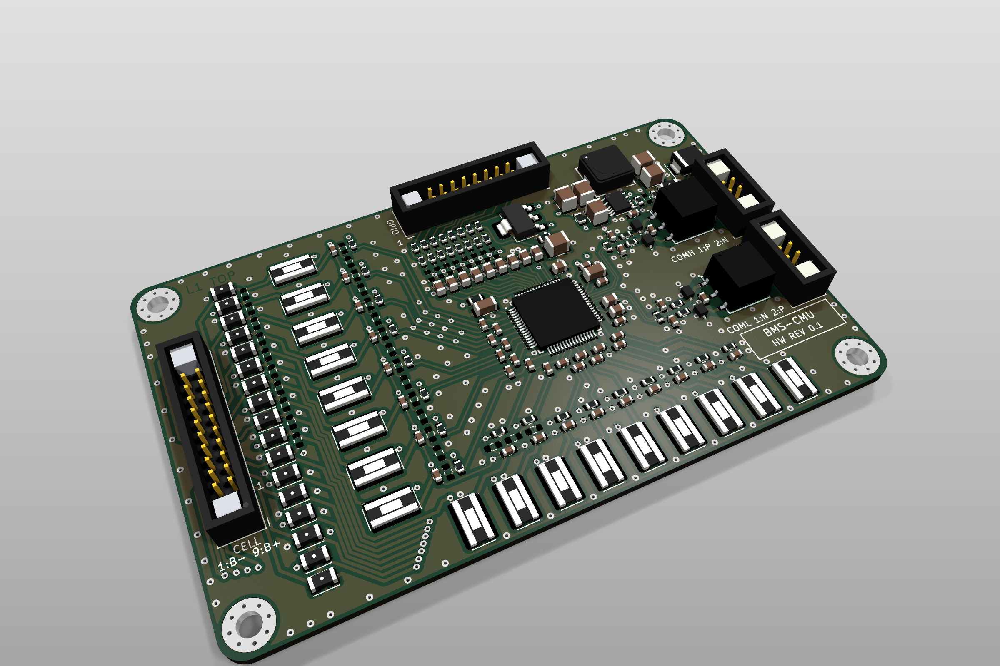
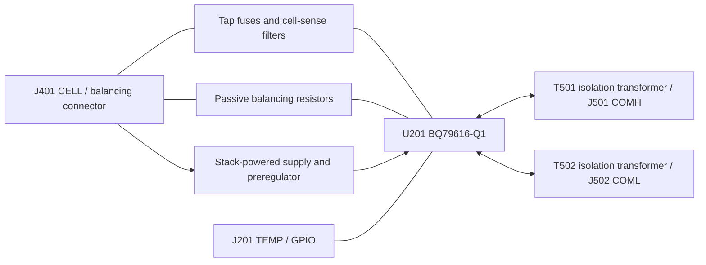

# BMS Cell Monitoring Unit (CMU) — Hardware

Native KiCad 10 design files for the cell-monitoring unit of open-source battery management system. Built around the **Texas Instruments BQ79616-Q1** 16-cell battery monitor, supporting a modular **6S to 16S** stack.

Latest prepared package: **revision 0.1, 16S, exported 2026-10-24**.

- **Manufacturing files:** [package index](manufacturing/rev0.1-2026-10-24/README.md), [complete package ZIP](manufacturing/rev0.1-2026-10-24/complete-package.zip), and [fabrication-only ZIP](manufacturing/rev0.1-2026-10-24/fabrication.zip).
- **KiCad design files:** [schematics, PCB and project files](design/).
- **3D PCB:** [open the latest populated STL](manufacturing/rev0.1-2026-10-24/3d/CMU-rev0.1-16S.stl) in GitHub.
- **EM simulations — coming soon:** [models and planned results](sim/em/README.md).
- **Thermal simulations — coming soon:** [models and planned results](sim/thermal/README.md).

<table>
  <tr>
    <th width="33%">PCB — rev 0.1, 16S</th>
    <th width="33%">EM simulation</th>
    <th width="33%">Thermal simulation</th>
  </tr>
  <tr>
    <td align="center"><a href="manufacturing/rev0.1-2026-10-24/3d/CMU-rev0.1-16S-raytraced.png"></a></td>
    <td align="center"><a href="sim/em/README.md">Coming soon</a></td>
    <td align="center"><a href="sim/thermal/README.md">Coming soon</a></td>
  </tr>
</table>

**Revision 0.1 — routed prototype, manufacturing package prepared.** The saved
schematic and eight-layer PCB pass the configured ERC and refilled DRC with
zero violations, unconnected items or schematic/PCB mismatches (KiCad 10.0.4,
2026-10-24). This is file-level validation; thermal, SI, fault and hardware
bring-up validation remain open.

The [manufacturing package](manufacturing/rev0.1-2026-10-24/README.md) contains
fabrication, assembly, schematic, mechanical and purchasing files. Purchase
**194 components**: 157 fitted plus all 37 DNP parts retained unfitted. See the
[manufacturing record](docs/CMU-009-manufacturing.md) for acceptance limits.

## Safety warning

This repository is not a certified battery-management product. Lithium battery
systems can cause electric shock, fire, explosion, toxic smoke, severe injury,
property damage, or death. The design has not been certified for functional
safety, automotive use, charging protection, cell balancing, isolation, EMC,
thermal performance, or fault containment. Do not connect it to cells or
manufacture it without an independent schematic, PCB, component, firmware, and
safety review. Use appropriate fusing, current limiting, isolation, enclosure,
fire protection, and supervised test equipment.

## System context

One of three independent repositories:

| Module | Repository | Role |
|---|---|---|
| **CMU** | `bms-cmu-bq79616-hardware` (this one) | BQ79616-Q1 cell monitoring, 6S–16S, no MCU |
| BMU | `bms-bmu-stm32-bq79600-hardware` | STM32H757 + BQ79600-Q1 master, CAN-FD, SoC/SoH |
| BJB | `bms-bjb-bq79631-hardware` | BQ79631-Q1, shunt, contactor and precharge drivers |

The CMU is a slave with no autonomous protection authority. It measures,
balances, reports faults over an isolated daisy chain, and the BMU decides. It
is powered entirely from the cell stack it monitors — there is no external
supply and no way to power it down short of disconnecting its cell taps.

Interfaces are specified in
[`docs/CMU-008-interface-control.md`](docs/CMU-008-interface-control.md), which
the other two repositories cite by tag.

## Design summary



| Item | Value |
|---|---|
| Monitor | BQ79616-Q1, 16 channels, 6S–16S |
| Cell taps | J401 Harwin M80-5002042 fitted; J402/J403 are schematic-only alternatives |
| Tap protection | 17 fitted tap fuses F401–F417; one additional supply fuse F601 |
| Balancing | Passive, 105 mA per channel |
| Temperature | 8 channels via J201; R219–R226 onboard NTC positions DNP |
| Supply | LTC3639 150 V buck to 8.8 V, self-powered from the stack |
| Board draw | up to 16.1 mA from the pack, ACTIVE worst case, balancing excluded |
| Daisy chain | Transformer-isolated COMH/COML |
| Sheets | 7 (root + bq79616, balance, cells, com, batterypositive_to_8V8, mechanical) |
| PCB population | 198 footprints: 157 fitted, 37 DNP, 4 mounting holes |

## Repository layout

```text
bms-cmu-bq79616-hardware/
|-- README.md
|-- LICENSE                     CERN-OHL-P-2.0
|-- LICENSES/
|-- .gitignore
|-- .gitattributes
|-- design/                     authoritative source
|   |-- battery_management_system_cell_monitoring_unit.kicad_pro
|   |-- battery_management_system_cell_monitoring_unit.kicad_sch    root sheet
|   |-- battery_management_system_cell_monitoring_unit.kicad_pcb    routed PCB
|   |-- bq79616.kicad_sch
|   |-- balance.kicad_sch
|   |-- cells.kicad_sch
|   |-- com.kicad_sch
|   |-- batterypositive_to_8V8.kicad_sch
|   |-- mechanical.kicad_sch
|   |-- sym-lib-table
|   |-- fp-lib-table
|   `-- kicad-libraries/        imported parts; README.md is the manifest
|-- docs/                       engineering documentation
|   |-- README.md               index, ordered by phase
|   |-- CMU-001 .. CMU-008      analyses
|   |-- CMU-009-manufacturing.md release and configuration record
|   `-- generated/              exports; never hand-edited
|-- manufacturing/              intentional versioned prototype packages
|-- sim/                        planned circuit, EM and thermal simulations
|   |-- README.md               index; every sim names the claim it verifies
|   |-- lib/                    shared params and vendor models
|   |-- transient/
|   |-- daisy-chain/
|   |-- em/                     coming soon
|   `-- thermal/                coming soon
`-- tools/
    `-- gen_doc_tables.py       regenerates doc tables from the netlist

Imported-part content identifiers are recorded in design/kicad-libraries/README.md.
No initial upstream commit exists yet; docs/generated/library-provenance.csv records
the present hashes. identify_asset.py can resolve commits once history exists.
```

Files in `design/` are authoritative. Everything in `docs/generated/` is
reproducible output and does not replace the editable source.

## Opening the design

1. Install KiCad 10 with its standard symbol, footprint and 3D-model libraries.
2. Open `design/battery_management_system_cell_monitoring_unit.kicad_pro`.
3. Confirm `custom_symbols` and `custom_footprints` load from the project-local
   tables at `${KIPRJMOD}/kicad-libraries/`.
4. Run ERC. It should report **0 violations**; anything else is a regression.

Standard 3D models resolve through `${KICAD10_3DMODEL_DIR}`. Original models use
`${KIPRJMOD}/kicad-libraries/3d_models/custom_3dmodels.3dshapes/`. No
environment variable or machine-specific absolute path is required.

### Which repositories to clone

`design/kicad-libraries` holds **imported copies of the parts this board uses**,
taken from `github.com/gerhardmalberg88/kicad-libraries`. The path is
load-bearing — the library tables and every footprint's 3D reference resolve
through it. It ships with this repository, so most work needs nothing else.

| Task | Clone |
|---|---|
| Use, review, or generate manufacturing files | **This repository only** |
| Design work that needs no new part | **This repository only** |
| Adding a part the board does not have yet | This repository, then `kicad-libraries`; import the part and record it in the manifest |
| Changing a part | This repository, then `kicad-libraries`; **make the change upstream**, commit it there, then re-import |

The last two rows carry the rule that matters. **Never edit
`design/kicad-libraries` in place** — a change made here is invisible to every
other board, and saving a file through the KiCad editor rewrites its UUIDs and
generator string, which breaks identification with no design change.

It holds only what the board uses: 5 symbols, 21 footprints and 12 models. Carrying the rest would mean re-importing whenever a
part belonging to a different board changed.

After placing a symbol that is not in the project library yet, rebuild it from
the schematics rather than copying by hand or saving through the symbol editor:

```console
python ../kicad-libraries/tools/build_symbol_library.py --used-by design \
    --output design/kicad-libraries/symbols/custom_symbols.kicad_sym
```

Copy the part's footprint and model across as well, then add all three to the
manifest. `--check` instead of writing reports whether the library has drifted
from its sources.

Upstream, each symbol is its own library — `ltc3639:LTC3639`. This
project keeps a single `custom_symbols` library of imported copies, so its
`lib_id`s stay stable no matter how the upstream library is organised. The
symbol blocks are copied without a byte changed, so each still identifies
against the file it came from.

### Which library version each part came from

No version number is recorded in any asset. Git names every object by the SHA-1
of its contents, so the content *is* the version.
[`design/kicad-libraries/README.md`](design/kicad-libraries/README.md) is both
the licence notice and the import manifest, listing every file with the upstream
commit and blob it came from. To check the whole set against the library:

```console
python ../kicad-libraries/tools/identify_asset.py \
    --upstream ../kicad-libraries --manifest design/kicad-libraries/README.md
```

Every asset should report `EXACT`. `EQUIVALENT` means the design still matches
but the bytes do not — an editor save or a KiCad format migration rather than a
design change. `DIVERGED` means a part was genuinely edited; re-run with
`--show-diff` to see what. Exits 0 when everything is identified, 1 when
anything diverged, 2 when anything is not from that library, 3 when the upstream
path is not a git repository. Run it before a release.

The three methods, and the two things that break them, are documented once, in
the [library README](https://github.com/gerhardmalberg88/kicad-libraries#version-checking).
They are not repeated here.

## Documentation

[`docs/`](docs/) holds the engineering documentation, ordered by phase rather
than by number, because several analyses are *inputs* to layout rather than
descriptions of it:

- **Pre-layout** — requirements, interface control, power budget, FMEA,
  stress/WCCA, layout constraints
- **Post-layout** — thermal, signal integrity
- **Manufacturing** — release, configuration and open confirmations; design
  decisions are recorded in the analyses they affect

Start at [`docs/README.md`](docs/README.md).

Component `Description` fields in the schematic carry the reasoning behind
individual part choices. The documents cite designators and summarise rather
than duplicating that text, so each fact has one source.

## Revision and configuration control

The title block on all seven sheets is driven by **text variables defined once**
in the `.kicad_pro`: `BOARD_TITLE`, `REV`, `ISSUE_DATE`, `ORG`, `LICENSE`,
`COPYRIGHT`, `SOURCE`, `MODULE`. KiCad 10 does not inherit title-block fields
from the root sheet, so this is the only single-source mechanism available.
Bump a revision by editing one file.

Revision scheme: **`0.x`** while unfabricated, **`A`, `B`, `C`** for each
fabricated board. Each release should carry a matching annotated git tag.

Reference designators use per-sheet hundreds blocks — `bq79616` 200, `balance`
300, `cells` 400, `com` 500, `batterypositive_to_8V8` 600 — so a designator
names its page and adding parts to one sheet never renumbers another.

## Manufacturing

The current package is [`manufacturing/rev0.1-2026-10-24/`](manufacturing/rev0.1-2026-10-24/README.md).
It targets Eurocircuits and the current 16S assembly, retaining revision 0.1.
`fabrication.zip` contains only bare-board production data and fabrication
instructions. `complete-package.zip` also includes assembly, purchasing,
schematic PDF, STEP/STL and verification records.

See [`docs/CMU-009-manufacturing.md`](docs/CMU-009-manufacturing.md) for the
repeatable export commands, population rules and open confirmations. View the
[populated STL](manufacturing/rev0.1-2026-10-24/3d/CMU-rev0.1-16S.stl) directly
in GitHub's 3D viewer. The binary mesh is below 10 MB and must remain a normal
Git file for that viewer.

This local package has no source commit/tag because the repository has no
initial commit. Exact source SHA-256 hashes and a source snapshot identify it.
A published immutable release should subsequently identify a reviewed commit
and annotated tag. Never silently replace files in a published release.

## Licensing

Copyright (C) 2021-2026 Gerhard Malberg.

**Everything in this repository is CERN-OHL-P-2.0** — the hardware design, the
KiCad project, the schematics, the PCB, the engineering documentation under
`docs/`, the simulation material under `sim/`, and the imported component
library in `design/kicad-libraries/`. The licence text is in `LICENSE` and
`LICENSES/CERN-OHL-P-2.0.txt`, and `design/kicad-libraries/README.md` carries
the notice for the imported parts rather than a second copy of the text.

[NOTICE.md](NOTICE.md) records the applicable copyright, provenance and
third-party notices, which also accompany the standalone manufacturing archives.

The one exception is content this repository does not own: KiCad's stock symbols
and footprints, used for standard passives and embedded into the `.kicad_sch`
and `.kicad_pcb`, remain CC BY-SA 4.0 with the KiCad library exception. That
exception exists precisely to allow their use in a design without the design
inheriting CC BY-SA. Their texts are in `LICENSES/`.

A permissive licence throughout means the library can be shared across all three
BMS modules and `bldc-controller-hardware` without forcing terms onto anyone who
builds on it, and there is no boundary inside the repository where one licence
stops and another starts.

Commercial manufacture and modification are permitted under CERN-OHL-P-2.0.
These notes are conservative project metadata, not legal advice.

## Third-party content

The design uses KiCad's stock symbol and footprint libraries for standard
passives, which KiCad embeds into the `.kicad_sch` and `.kicad_pcb`. These are
CC BY-SA 4.0 with the KiCad library exception, and that exception permits use in
a design without the design inheriting CC BY-SA.

Every imported part in `design/kicad-libraries/` is CERN-OHL-P-2.0 original
work with no third-party CAD content. Which upstream commit each came from is
recorded in
[`design/kicad-libraries/README.md`](design/kicad-libraries/README.md); the
upstream asset-level register, one row per symbol, footprint, model and source,
stays in the `kicad-libraries` repository rather than being copied here.

Manufacturer datasheets are referenced by URL from each component's `Datasheet`
field. No third-party document is redistributed with this repository.

Manufacturer, distributor, product and service names are trademarks of their
respective owners. Their use is descriptive and implies no affiliation or
endorsement.

## Contribution and release rules

- Do not change circuit connectivity, footprints, stack-up, routing, zones, or
  board outline in a formatting-only commit.
- Add source, author, licence, modification and redistribution evidence for
  every non-standard library asset, in the same commit.
- Keep the four sourcing fields named exactly `MPN`, `digikey_pn`, `MPN_alt`,
  `digikey_pn_alt`. Inconsistent capitalisation splits BOM columns.
- Do not commit KiCad backups, locks, caches, session files or scratch output
  under `build/`. Intentional versioned files under `manufacturing/`, including
  the STL preview, and regenerated `docs/generated/` are permitted.
  `.kicad_prl` remains per-user UI state and is ignored.
- Regenerate `docs/generated/` whenever a reviewed design change is released,
  and run `python tools/gen_doc_tables.py --check` so documentation tables
  cannot drift from the schematic.
- **Close KiCad before scripted edits.** KiCad writes whole sheets from its
  in-memory copy on save and will silently discard external changes.
- Reannotating invalidates every designator cited by name in documentation and
  schematic text. Rewrite those citations in the same operation.
- Record ERC and DRC tool versions and results. Do not hide violations without
  dated engineering rationale in the affected analysis and the manufacturing record.

## No warranty

The design and documentation are provided as-is, without warranties of
correctness, merchantability, fitness for a particular purpose, safety,
non-infringement, or regulatory compliance. To the extent permitted by law, the
contributors disclaim liability for any loss, injury, fire, battery damage,
product failure, or other consequence arising from use, manufacture,
modification, or distribution.
