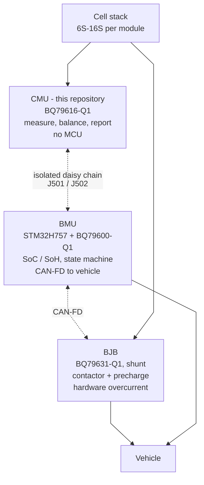

# CMU-001 — Requirements and System Context

> **Document zero.** Everything else hangs off this. Without it CMU-004 has no
> pass/fail criterion and CMU-003 has no severity scale. Fill this before
> treating any other analysis as complete.

## 1. System context

Three independent repositories, one system:

| Module | Repository | Role |
|---|---|---|
| **CMU** | `bms-cmu-bq79616-hardware` | Cell monitoring, 6S–16S. BQ79616-Q1, cell filters, passive balancing, NTC, COMH/COML. **No MCU.** |
| **BMU** | `bms-bmu-stm32-bq79600-hardware` | Master. STM32H757 + ST67W611M1, BQ79600-Q1, CAN-FD, USB/debug, SoC/SoH, state machine, 50–7 V DC-DC |
| **BJB** | `bms-bjb-bq79631-hardware` | Junction box. BQ79631-Q1, low-side shunt, pack/link dividers, contactor and precharge drivers, hardware overcurrent, isolation measurement, isolated DC-DC to 12 V |

The CMU is a **slave**. It has no autonomous protection authority: it measures,
balances, reports faults over the daisy chain, and the BMU decides. It is
powered entirely from the cell stack it monitors — see
[CMU-008](CMU-008-interface-control.md) §6.

Interfaces are specified in [CMU-008](CMU-008-interface-control.md), which the
other two repositories cite.

## 2. Functional requirements

*To be completed.* Each requirement needs an ID (`REQ-CMU-nnn`), a verifiable
statement, and a verification method.

- [ ] Cell count range and per-cell voltage range
- [ ] Measurement accuracy over temperature
- [ ] Balancing current and duty cycle
- [ ] Temperature sensing channel count and accuracy
- [ ] Fault detection and reporting latency
- [ ] Daisy-chain data rate and maximum cable length
- [ ] Startup, sleep and shutdown behaviour

Known from the saved design; no fabricated-board verification is recorded:

| Item | Value | Source |
|---|---|---|
| Cell count | Current assembly: 16S; design supports 6S–16S variants | J401 carries VC0–VC16; J402/J403 are schematic-only alternatives |
| Balance current | 105 mA/channel | Two 20 R in the loop at 4.2 V |
| Temperature channels | 8 | External sensors via J201; R219–R226 onboard NTC positions remain DNP |
| Supply | Self-powered from taps | CMU-002 §2 |

## 3. Environmental and operating requirements

- [ ] Operating and storage temperature — components are −55/−40 to +125 °C; the
      **specified** range is what CMU-004 derates against and is not yet fixed
- [ ] Vibration and shock
- [ ] Humidity, condensation, ingress
- [ ] Altitude, if creepage/clearance must be derated
- [ ] Expected service life and duty cycle

## 4. Standards and grade

- [ ] Which standards are targets versus aspirations
- [ ] Whether functional safety (ISO 26262 or IEC 61508) is a goal or a posture

The project aspires to aerospace-grade practice. Qualification is
component-specific; the BOM must not be described as entirely AEC-Q qualified.
Neither component selection nor connector grade qualifies the assembled CMU.

## 5. Safety goals (provisional)

> **These are assumptions, not agreed goals.** Real safety goals are allocated
> at system level; an agreed BMU safety allocation is not recorded here.
> **FMEDA is blocked on this section**, not merely deferred.

Working assumptions:

- **SG-1 (provisional).** No single CMU failure shall energise, short or
  otherwise endanger the cell stack. A CMU that dies safely is an acceptable
  outcome; one that keeps the pack energised into a fault is not.
- **SG-2 (provisional).** No single CMU failure shall cause an undetected loss
  of cell monitoring. Silent failure is worse than loud failure.
- **SG-3 (provisional).** The isolation barrier between pack potential and the
  daisy chain shall not be defeated by any single failure.

Reconcile with the BMU's safety concept when it exists, then revisit CMU-003.

## 6. Acceptance

- [ ] Every requirement has an ID and a verification method
- [ ] Severity scale defined so CMU-003 can be rated
- [ ] Environmental range fixed so CMU-004 has a derating basis
- [ ] Safety goals agreed at system level, unblocking FMEDA
