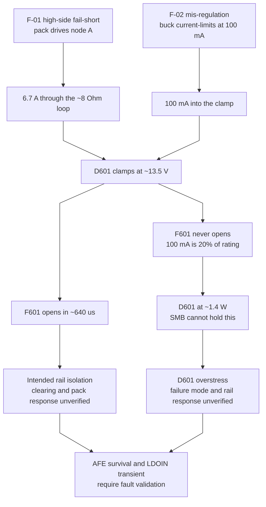

# CMU-003 — Design FMEA

> Current PCB configuration: J401 only; J402/J403 and their fuse banks are schematic-only alternatives. Existing failure-mode analysis remains a draft, not a completed sign-off.

## 1. Scope and honesty about coverage

This is a **seeded register, not full coverage**. It holds the failure modes
analysed in detail so far — the supply chain, the pass element, the protection
devices and the cell-tap interface. It does **not** yet cover all 194 physical
component positions (157 fitted and 37 DNP).

That is deliberate. The value of this document before layout is not
completeness; it is that **its output is layout constraint**. Every row carries
a "layout consequence" column, and those feed
[CMU-005](CMU-005-layout-constraints.md).

**Criticality (FMECA) is deferred.** Ranking needs part failure rates, which
depend on junction temperature, which needs [CMU-006](CMU-006-thermal-analysis.md).
Close the criticality column after layout.

**Diagnostic coverage (FMEDA) is blocked**, not deferred. It needs system safety
goals; an agreed BMU safety allocation is not recorded here. See
[CMU-001](CMU-001-requirements.md) §Safety goals (provisional).

## 2. Method

Design FMEA at component and function level. Severity is judged against the
worst credible system effect, with **pack-level thermal runaway or fire as the
top severity** — a CMU that dies safely is a far better outcome than one that
keeps the pack energised into a fault.

Ratings are omitted until CMU-001 fixes the severity scale.

## 3. Failure modes

### 3.0 How the supply-chain faults resolve

**Proposed fault sequence, not verified behavior.** The diagram and register
retain the design hypotheses. Fuse clearing, TVS failure mode, AFE survival
and pack safety have not been demonstrated; a TVS must not be assumed to fail
short reliably. The simulations are still scaffolding. Historical acceptance
decisions are recorded with the affected failure modes below; they are not
evidence of fault qualification.

The intended mechanisms are **F601 clearing the hard short and D601 clamping
mis-regulation**. Whether either branch reaches the illustrated state depends
on component limits, fault energy and transient behavior. The NPNB loop alone
does not establish AFE survival under an arbitrary fault.

### 3.1 Supply chain

| # | Item | Mode | Cause | Local effect | System effect | Mitigation | Layout consequence |
|---|---|---|---|---|---|---|---|
| F-01 | U601 LTC3639 | High-side switch fail-short | Silicon failure, overstress | Node A rises to pack voltage through L601 | Would put 67 V on an 8.8 V rail | D601 clamps, F601 opens in ~640 µs at the 6.7 A the ~8 Ω loop allows. Fuse interrupting rating 50 A ≫ 8.3 A worst case | F601 and D601 must be adjacent; keep the clamp loop tight |
| F-02 | U601 | Mis-regulation, still switching | Feedback path open (R602/R603), control fault | Output rises until current limit | Q201 would dissipate (67−6) × 25 mA = **1.5 W** in SOT-223 and cook | **D601 alone.** F601 cannot clear this — the LTC3639 limits at 100 mA, which is 20 % of the fuse rating and the datasheet is 4 h minimum at 100 %. With the clamp, Q201 sees 0.2 W | D601 needs copper for ~1.4 W; see F-06 |
| F-03 | C601 ∥ C602 | Fail short | MLCC flex crack, overvoltage | Pack shorted through L601 1.65 Ω → ~40 A | **Fire risk.** L601 burns | 100 V X7S rating (67 % of rating at 16S in the post-fault state); split into 2× 1210 rather than 1× 2220 because crack risk scales with package length | **Keep away from board edges, mounting holes and depanel routes.** Orient so board flex acts along, not across, the part |
| F-04 | L601 | Open | Winding failure, fault current | Rail collapses | Monitoring lost; pack response depends on BMU handling | Validate system response to communication loss | — |
| F-05 | F601 | Nuisance open | Ageing, assembly damage or overstress | Rail collapses | Monitoring lost; pack response depends on BMU handling | Normal load is 25 mA against a 500 mA part, ~5 % of nameplate; this alone does not establish service life | — |

### 3.2 Protection devices

| # | Item | Mode | Cause | Local effect | System effect | Mitigation | Layout consequence |
|---|---|---|---|---|---|---|---|
| F-06 | D601 SMBJ12A-Q | Thermal overstress during sustained clamp | F-02 estimate ~1.4 W; SMB θJA ≈ 100 °C/W typ, TJ max 150 °C | Junction temperature rises; failure mode and rail voltage are not bounded | AFE damage and loss of monitoring remain possible | Historical SMB selection retained; fail-short and AFE survival are not guaranteed. Validate fault energy and thermal limits | Maximum practical copper on both pads; verify actual thermal resistance |
| F-07 | D601 | Conducts in normal operation | **Standoff chosen against the 8.8 V rail instead of the 11.1 V OTP rail** | Continuous conduction, F601 opens | Board dead on first OTP programming attempt | 12 V standoff, VBR min 13.3 V, leaves 2.2 V over the 11.1 V R604-fitted rail. A 10 V part (VBR min 11.1 V) would fail here | Document on the assembly drawing that R604 and D601 interact |
| F-08 | Tap fuse (F401–F417 fitted; F418–F451 schematic-only) | Open | Tap short, mis-mate | That tap floats | AFE reports open wire; one cell unmonitored | BQ79616 open-wire diagnostic detects it | Star topology — one fuse per connector pin; fault containment requires validation |
| F-09 | Tap fuse | Fails to interrupt | Prospective fault above rating | Sustained arc | **Fire risk** | Historical ~40 A estimate versus 50 A @ 125 VDC rating gives only ~1.25× nominal margin; pack/harness impedance and clearing require validation | Creepage between adjacent tap nets sized for the worst 67 V pair |

Historical selection rationale consolidated **2026-10-24** (the original
acceptance dates were not recorded): D601's SMB package was retained for size;
a larger SMC package was considered but was not evidence of indefinite fault
survival. The earlier fail-short assumption is unverified. The Littelfuse 470
was selected over Schurter MGA-A on cost, accepting a lower stated interrupting
rating (50 A versus 300 A). The current assembly has **18 fuses**; the earlier
costing population is obsolete. Revisit the selection if pack/harness impedance
or qualification requirements change. Neither decision closes F-06/F-09.

### 3.3 Pass element and AFE interface

| # | Item | Mode | Cause | Local effect | System effect | Mitigation | Layout consequence |
|---|---|---|---|---|---|---|---|
| F-10 | Q201 | **Collector–emitter short** | Silicon failure | LDOIN sees rail minus R201 drop, ~8.7 V | **LDOIN absolute maximum is −0.3 to +9 V.** Nominal DC margin at 8.8 V is under 300 mV; survival is unverified. **With R604 fitted for OTP the 11.1 V rail exceeds the limit** | None presently. R201 drops only 4.7 Ω × 25 mA = 118 mV | Candidate LDOIN clamp remains unspecified — see O-2 |
| F-11 | Q201 | Base–emitter short | Silicon failure | NPNB tied to LDOIN, regulation loop lost | LDOIN collapses, AFE browns out | Benign failure direction | — |
| F-12 | Q201 | Open (any junction) | Silicon failure, solder crack | LDOIN unpowered | Monitoring lost; pack response depends on BMU handling | Validate system response to communication loss | SOT-223 tab is the thermal path; solder it fully |
| F-13 | Q201 | Full C–B–E short | Silicon failure | 8V8 onto NPNB, which is rated for 1.15 mA max drive | AFE destroyed | None presently; LDOIN clamping alone does not establish NPNB protection | See O-2 |

### 3.4 Cell-tap interface

J401 is the only cell-tap connector on this PCB. References to J402/J403 below
describe retained schematic alternatives, not additional fitted connectors.
The historical ~133 mA mis-mate estimate is not an acceptance criterion:
four 4.2 V cells across 40 ohms alone give 420 mA. The actual path and internal
clamping must be established before assigning a fault-current limit.

| # | Item | Mode | Cause | Local effect | System effect | Mitigation | Layout consequence |
|---|---|---|---|---|---|---|---|
| F-14 | J401/J402/J403 | **Mis-mate / hot-plug out of order** | 20-way connector mating a builder-crimped harness with no factory wire marking | Large ΔV across adjacent VC and CB pins during insertion | The constraint is asymmetric: `VCn to VCn-1` tolerates **±80 V**, but `CBn to CBn-1` only **−0.3 to +16 V**. CB is what breaks | Two 20 R balance resistors provide series impedance; the historical ~133 mA limit is unverified (see section 3.4). Pin ordering minimises the worst adjacent pair for each geometry: interleaved on the 2x10 J401 gives 2 cells ≈ 8.4 V, sequential on the 1x20 J402/J403 gives 1 cell ≈ 4.2 V | Preserve pin order; cell-tap TVS not fitted — see O-6 for the tradeoff and reconsideration conditions |
| F-14a | J401/J402/J403 | *Not a failure mode* — connecting a healthy pack in the correct order is a normal operating transient, analysed in [CMU-004](CMU-004-stress-and-wcca.md) §5.1. F-14 covers only the out-of-order case | — | — | — | — | — |
| F-15 | J401/J402/J403 | **A tap wired twice** | Assembly error, or a split harness that terminates a boundary node on both connectors | Two fuses in parallel on that tap | That tap has 1 A of protection where every other has 500 mA, defeating the star topology on the node most likely to fault in a modular pack | `Assembly condition` on all three, and the boundary-node rule in CMU-008 §3.3.1 | Mark on the assembly drawing and silkscreen |
| F-15a | J401/J402/J403 | **A tap wired zero times** | Split harness with a gap | That tap floats | AFE reports open wire; one cell unmonitored | BQ79616 open-wire diagnostic detects it; wire schedule per CMU-008 §3.3 | — |
| F-16 | Tap wiring | Reverse insertion | Connector not keyed against 180° insertion | Full pack reversed across VC inputs | Potentially fatal to the AFE | **Open.** Verify the chosen connector's polarisation | Keying orientation is a layout/mechanical decision |

## 4. Open items

| Ref | Item |
|---|---|
| O-1 | F-16 reverse insertion is unmitigated — confirm connector polarisation |
| O-2 | F-10/F-13 remain unmitigated. Candidate: LDOIN-to-AVSS clamp above the OTP operating voltage (~8 V) and below the 9 V absolute maximum under fault current. No part specified; tolerance, dynamic clamp voltage and dissipation need review. F601/D601 are upstream of Q201 and do not bound its emitter. F-13 also exposes NPNB and requires a separate protection-path analysis |
| O-3 | Coverage: 194 physical component positions (157 fitted, 37 DNP), ~16 analysed. Extend to the balance network, NTC chain, COM interface, and every connector |
| O-4 | Criticality column blocked on CMU-006 |
| O-5 | FMEDA blocked on BMU safety goals |
| O-6 | F-14 remains unvalidated. Cell-tap TVS were historically not adopted because leakage across individual cells, temperature dependence and mismatch affect storage life and imbalance. Reconsider when storage requirements and leakage at actual cell voltage are characterised, or fault/transient evidence shows additional clamping is necessary. No safe residual-risk conclusion is established |
| O-7 | F-01 and F-14 have simulations planned in [`../sim/`](../sim/); neither mitigation has been checked against anything but arithmetic |

## 5. Sources

- BQ79616-Q1 SLUSE81F — absolute maximum ratings, LDOIN regulation, NPNB drive
- LTC3639 3639fd — current limit, `IPEAK` vs ISET
- Component `Description` fields in the schematic — per-part reasoning
- [CMU-002](CMU-002-power-budget.md) §9 — fault-mode currents
