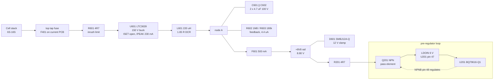
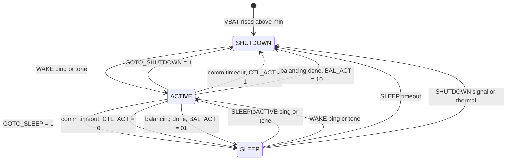

# CMU-002 — Power Budget and Load Analysis

> **2026-10-24 prototype record:** population below refers to the fitted 16S
> PCB. Calculated currents and powers remain design estimates, not bench
> measurements or a validated maximum balancing schedule. See
> [CMU-009](CMU-009-manufacturing.md) for the exported configuration.

## 1. Scope

Every current the CMU draws, where it comes from, and what each element in the
supply chain must therefore tolerate. Covers 6S to 16S.

This document is entirely schematic-level and **does not depend on layout**.
The only figure that changes after hardware exists is measured buck efficiency,
which refines §7 rather than replacing it.

§8 (per-component dissipation) is deliberately pulled forward from
[CMU-006](CMU-006-thermal-analysis.md) because it constrains placement, and placement is
decided before thermal analysis is possible.

## 2. Supply architecture

The board takes **no external supply**. It is powered from the cell stack it
monitors, through the top and bottom tap fuses.



The `+8V8` rail's entire load is the LDOIN supply — the netlist shows exactly
three connections on it: F601, D601 and R201.

LDOIN is regulated to **6 V typical** by the AFE's own NPNB loop through Q201,
and to **8 V nominal** during OTP programming. TI require **VCollector ≥ 8 V at
all times**, assuming ~2 V across the NPN. That requirement is what sets the
8.80 V rail.

Two consequences worth stating plainly:

- **The buck is always on.** `RUN` is tied to the input supply, so the rail
  stays up in every AFE power mode. Board draw never falls to the AFE's own
  sleep current.
- **There is no way to power the CMU down** short of disconnecting its cell
  taps.

## 3. Power modes



### 3.1 What runs in each mode

From BQ79616-Q1 Table 7-34:

| Function | SHUTDOWN | SLEEP | ACTIVE |
|---|---|---|---|
| Main ADC / AUX ADC | | | ✓ |
| OV/UV and OT/UT protectors | | ✓ ¹ | ✓ |
| **Cell balancing** | | **✓ ¹** | ✓ |
| OTCB detection | | ✓ ¹ | ✓ |
| Module balancing | | | ✓ |
| **UART / vertical communication** | | | **✓** |
| Fault status and NFAULT communication | | ✓ | ✓ |
| Comm timeout | | | ✓ |
| SLEEP timeout | | ✓ | |
| Thermal shutdown detection | | ✓ | ✓ |
| SPI master, OTP programming | | | ✓ |
| Always-on POR detection | ✓ | ✓ | ✓ |

¹ Must be enabled in ACTIVE first, then the device put to SLEEP.

The two timeouts are what drive the transitions in the diagram above, which is
why they sit in different columns: comm timeout runs in ACTIVE and is what moves
the device to SLEEP or SHUTDOWN when the host goes quiet, while SLEEP timeout
runs in SLEEP and is what moves it on to SHUTDOWN.

**SHUTDOWN runs only the always-on POR block.** No fault reporting, no
protectors, no comms — the device is idle apart from watching for a WAKE
ping.

### 3.2 Balancing in SLEEP

Cell balancing **does** run in SLEEP (§7.3.3.2): configure and start it in
ACTIVE, then set `CONTROL1[GOTO_SLEEP]`, and it continues autonomously. Setting
`BAL_CTRL2[BAL_ACT1:0]` makes the device drop to SLEEP or SHUTDOWN by itself
once `BAL_STAT[CB_DONE]` is set, with no host interaction.

But **`ISLP(IDLE)` = 220 µA is specified with no cell balancing.** Balancing
adds `ICB_EN`, 1.0 typ / **1.5 mA** max. So:

| SLEEP condition | AFE supply current |
|---|---|
| Idle, no balancing | 120 typ / **220 µA** max (−40…125 °C) |
| **Balancing active** | ~1.2 typ / **1.7 mA** max |

On top of that, the balancing itself draws **105 mA per active channel** from
the cell being balanced, through the external resistors. That is by far the
dominant drain and it is unaffected by power mode.

**The 220 µA figure and balancing are mutually exclusive** — while balancing is
running.

### 3.2.1 When balancing finishes

`ICB_EN` is present only while at least one balancing FET is on. Once
`BAL_STAT[CB_DONE]` sets, the FETs turn off, the adder disappears, and the
device settles back to the 120 typ / 220 µA max idle SLEEP current with no host
intervention. The sequence is autonomous in both directions: enter SLEEP with
balancing running, and leave balancing without leaving SLEEP.

Completion is not announced. UART is unavailable in SLEEP, so `CB_DONE` is
readable only after the next `SLEEPtoACTIVE` ping.

`BAL_CTRL2[BAL_ACT1:0]` sets where the device lands on completion — `01` for
SLEEP, `10` for SHUTDOWN, the latter dropping it to 23 µA instead of 220 µA.
Devices in a daisy chain finish at different times, so for a period they sit in
different power states.

### 3.3 The trade the BMU has to accept

**UART is not available in SLEEP.** Fault status and NFAULT are, but the BMU
cannot read cell voltages, temperatures or balance progress while the CMU
sleeps. Sleeping during a long balance therefore means balancing blind until
the next wake.

### 3.4 Waking needs no external timer

| Method | Signal | Wake time |
|---|---|---|
| `SLEEPtoACTIVE` ping / tone | 250–300 µs low on RX | **230 µs** |
| `WAKE` ping / tone | 2–2.5 ms low on RX | 1 ms |

Both arrive over the existing daisy chain from the BQ79600-Q1 in the BMU. No
timer, RTC or extra wake line is needed, and no change to
[CMU-008](CMU-008-interface-control.md) is implied.

The internal **SLEEP timeout** is not a wake source — it exits SLEEP to
**SHUTDOWN**, not to ACTIVE. Treat it as a backstop against a lost host, after
which a `WAKE` ping is required.

## 4. AFE current budget

From the BQ79616-Q1 datasheet (SLUSE81F) Electrical Characteristics, over
−40 °C to 125 °C:

| Parameter | Condition | Typ | Max | Unit |
|---|---|---|---|---|
| `IACT(IDLE)` | ACTIVE, no fault/comms/balancing | 10.4 | **11.6** | mA |
| `ICB_EN` | ≥1 balancing FET on, OTCB enabled | 1.0 | **1.5** | mA |
| `IADC` | 2 ADCs converting | 0.6 | **0.9** | mA |
| `ICOMT` | daisy-chain 128-byte broadcast, transformer isolation | — | **10** | mA |
| `IPROTCOMP` | protector comparator on | 20 | **60** | µA |
| `ITSREF` | SLEEP, no load on TSREF | — | **100** | µA |
| `IOW_SINK/SOURCE` | open-wire test | 500 | **600** | µA |
| `ISLP(IDLE)` | SLEEP, −40 to 125 °C, no balancing | 120 | **220** | µA |
| `ISHDN` | SHUTDOWN | 16 | **23** | µA |
| `ISTARTUP` | SHUTDOWN → ACTIVE inrush | **20** | — | mA |

All figures are the sum of `IBAT` + `ILDOIN`. `IBAT` is 150 µA in ACTIVE and is
drawn from the BAT pin, not through the 8V8 rail.

**Worst-case simultaneous draw on `+8V8`:**

```
11.6 + 1.5 + 0.9 + 10 + 0.06 + 0.1 + 0.6 = 24.76 mA  →  25 mA
```

`ICOMT` is a burst during a 128-byte broadcast read, not a continuous load, so
25 mA is a peak rather than a duty-cycle figure. It is nonetheless the number
every element in the chain is sized against.

## 5. Board draw, balancing excluded

Balancing current is excluded throughout — it is a cell-to-resistor path, not a board
supply load, and it is quantified separately in §7 and §8.

Rail load excludes `ICB_EN` and includes the 4.4 µA drawn by the R602/R603
feedback divider (8.8 V / 1.98 MΩ), which is present in every mode.

| Mode | `+8V8` load | Rail power | Pack current @ 16S (67.2 V) | @ 6S nom (22.2 V) | @ 6S low (15 V) |
|---|---|---|---|---|---|
| ACTIVE, quiescent | 10.3 mA | 91 mW | 1.6 mA | 4.8 mA | 7.1 mA |
| ACTIVE + ADC | 11.2 mA | 99 mW | 1.7 mA | 5.2 mA | 7.8 mA |
| **ACTIVE worst case, comms burst** | **23.3 mA** | **205 mW** | **3.6 mA** | **10.9 mA** | **16.1 mA** |
| Startup inrush | 20 mA | 176 mW | 3.1 mA | 9.3 mA | 13.8 mA |
| SLEEP, no balancing | 224 µA | 2.0 mW | ~50 µA | ~150 µA | ~220 µA |
| SHUTDOWN | 27 µA | 0.24 mW | ~10 µA | ~30 µA | ~45 µA |

Pack current assumes ~85 % buck efficiency at milliamp loads. The two
low-power rows assume ~60 % and ~50 % respectively, because a step-down
converter is far less efficient at microamp loads; treat them as indicative
until measured.

**In the low-power modes the buck sets the floor, not the AFE.** The LTC3639's
own quiescent current (datasheet headline figure ~12 µA, drawn from VIN and
therefore not divided down by the conversion ratio) is comparable to or larger
than the entire reflected SHUTDOWN load. Chasing AFE sleep current below this
point buys nothing.

**Headline figure:** in normal ACTIVE operation without balancing the board
costs about **0.1 W**, which is **1.6 mA at 16S** and **7.1 mA at 6S low state
of charge**. Worst case with a comms burst it is 205 mW.

## 6. Headroom budget

TI's floor is VCollector ≥ 8 V. The rail is 8.80 V nominal
(`VFB` 0.800 V × (R602 1M8 + R603 180k) / R603 = 11.0).

| Element | Drop at 25 mA |
|---|---|
| F601 (Littelfuse 470, 0.5455 Ω cold) | **14 mV** |
| R201 (4R7) | **118 mV** |
| Total | **132 mV** |

VCollector = 8.80 − 0.132 = **8.67 V nominal**. Applying LTC3639 feedback
accuracy plus 1 % divider resistors gives a rail floor near 8.50 V, so
**VCollector ≥ 8.36 V worst case** — 360 mV of margin on the 8 V floor.

The fuse spends **14 mV of an ~800 mV budget, about 2 %**. R201 costs eight
times more than the fuse does.

## 7. Pack-side current and the tap fuses

The top and bottom tap fuses carry the board current **in addition to** balance
current. Balance current is set by **two** 20 R resistors in the loop, not one:

```
I_balance = 4.2 V / (20 Ω + 20 Ω) = 105 mA per channel
```

Worst case is **6S at low state of charge**, because the board is a constant-power
load: 16.1 mA of input current from §5.

**Top and bottom tap fuse duty: 105 mA balance + ~16 mA board ≈ 121 mA.**
Middle taps carry balance current only, 105 mA.

The Littelfuse 470 datasheet requires 25 % continuous derating on top of the
nameplate, plus a further temperature rerating from a curve that is drawn as
vector art and could not be extracted numerically; this family typically sits
around 55–65 % at 125 °C. Taking 60 %:

```
500 mA × 0.75 × 0.60 ≈ 225 mA effective at 125 °C
121 mA / 225 mA ≈ 54 %
```

Comfortable, with the caveat that the temperature figure is read off a curve
rather than tabulated.

## 8. Per-component dissipation

Pulled forward from CMU-006 because it constrains placement.

<!-- BEGIN GENERATED: dissipation-table (do not edit by hand) -->
| Value | MPN | Qty | Refs |
|---|---|---|---|
| 470nF 25V | CGA3E3X7R1E474K080AE | 34 | C301..C334 |
| 500mA 125V FF | 0470.500DRSNP | 18 | F401..F601 |
| 100R 0.1% | TNPW0603100RBEEA | 17 | R301..R358 |
| 20R 2W | RCL122520R0FKEG | 17 | R304..R362 |
| 1uF 25V X7R | GCJ21BR71E105KA12L | 11 | C203..C217 |
| 1k 1% | CRCW06031K00FKEAHP | 10 | R211..R505 |
| 10k 0.1% | RG1608P-103-B-T5 | 8 | R203..R210 |

_Fitted PCB population by value, reconciled with the schematic. DNP and schematic-only alternatives are excluded. Dissipation figures are hand-derived in the prose below._
<!-- END GENERATED -->

The dominant term is not on the supply rail at all:

| Element | Count | Each | Total | Condition |
|---|---|---|---|---|
| **20R 2W balance resistors** | 17 | **0.22 W** | **3.7 W** | preliminary allocation; simultaneous-channel behavior not validated |
| Q201 (SOT-223 pass) | 1 | 0.07 W | 0.07 W | (8.67 − 6) V × 25 mA |
| R201 (4R7) | 1 | 2.9 mW | 2.9 mW | 25 mA |
| Tap fuses (0.5455 Ω), F401–F417 | 17 | 6.0 mW | ~0.10 W | illustrative 105 mA in each fitted tap fuse; end-tap supply draw additional |
| F601 | 1 | 0.34 mW | 0.34 mW | 25 mA |
| LTC3639 | 1 | — | ~20 mW | ~85 % eff. at 205 mW out |

**Placement and validation.** The saved PCB distributes the 17 balance
resistors along two sides. The 3.7 W figure is a preliminary thermal allocation,
not a calculation of the BQ79616's permitted simultaneous balancing schedule.
Shared-node currents, balancing control, voltage/tolerance corners and duty
cycle must be reconciled before claiming a maximum in [CMU-006](CMU-006-thermal-analysis.md).
The available copper and resulting temperature rise remain to be evaluated.

## 9. Fault-mode currents

Covered in full in [CMU-003](CMU-003-fmea.md); listed here because they size the
supply chain.

| Fault | Current | Limited by |
|---|---|---|
| LTC3639 high-side fail-short, 16S | **6.7 A** | R601 4R7 + L601 1.65 Ω DCR + F601 0.55 Ω + two tap fuses ≈ 8 Ω |
| Same at 80 V `VBAT` max | 8.3 A | as above |
| Buck mis-regulation | **100 mA** | LTC3639 internal current limit |
| Tap-to-tap short through a connector | ~40 A | pack impedance and wiring only |

F601 clears the 6.7 A case in ~640 µs (0.0287 A²s / 6.7²). It **cannot** clear
the 100 mA case — that is 20 % of its rating, and the datasheet specifies 4 hours
minimum at 100 %. D601 covers that mode instead.

## 10. Acceptance criteria

- [ ] VCollector ≥ 8 V at 25 mA across all rail and resistor tolerances — **met, 8.36 V**
- [ ] `+8V8` peak ≤ LTC3639 100 mA rating — **met, 25 mA**
- [ ] Tap fuse duty ≤ 70 % of temperature-derated rating — **met, ~54 %**
- [ ] Fuse interrupting rating > prospective fault current — **met, 50 A vs 8.3 A**
- [ ] Board draw stated per mode, balancing excluded — **met, §5**
- [ ] Total board dissipation quantified for CMU-005 — **met, 3.7 W dominated by balancing**
- [ ] LTC3639 quiescent current confirmed against its electrical table — **open**
- [ ] Light-load buck efficiency measured, refining the SLEEP/SHUTDOWN rows — **open, needs hardware**

## 11. Sources

- BQ79616-Q1 datasheet SLUSE81F — supply currents, Table 7-34 mode summary,
  §7.3.3.2 balancing in SLEEP, Figure 7-59 power state diagram, LDOIN
  regulation, NPN sizing.
  <https://www.ti.com/lit/gpn/bq79616-q1>
- LTC3639 datasheet — `IPEAK` vs ISET, COUT selection, efficiency, quiescent
  current. <https://www.analog.com/en/products/ltc3639.html>
- Littelfuse 470 Series — resistance, melting I²t, derating.
  <https://www.littelfuse.com/products/fuses-overcurrent-protection/fuses/surface-mount-fuses/thin-film-chip-fuses/470>
- `docs/generated/netlist.net` — connectivity
