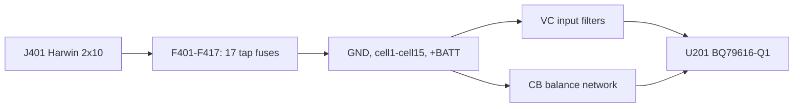
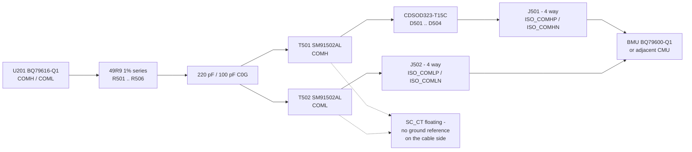

# CMU-008 — Interface Control Document

> **The BMU and BJB repositories are blocked on this document.** Cite it by
> repository URL and git tag, never by copying its tables — a copied pinout is
> a pinout that will silently diverge.

## 1. Scope

Every electrical interface the CMU presents at a connector: pinout, signal
levels, isolation and mating half. Internal circuitry is out of scope.

This document now describes the routed revision 0.1 PCB. Schematic-only
connector alternatives are retained as design options, not fitted interfaces
on the current board. Harness agreement and bring-up remain unvalidated.

## 2. Interface summary

| Connector | Function | Ways | Current PCB |
|---|---|---|---|
| J401 | Cell tap input, 6S–16S | 20 | Fitted Harwin M80-5002042 |
| J501 | Daisy chain COMH | 4 | Fitted Harwin M80-5T10442MC |
| J502 | Daisy chain COML | 4 | Fitted Harwin M80-5T10442MC |
| J201 | NTC temperature sensor interface | 16 | Fitted Harwin M80-5001642 |
| J402 / J403 | Alternative cell tap connectors | 20 each | Excluded from PCB and BOM |

The historical connector-selection decision retained Molex Mini50 as an
automotive-oriented alternative and selected Harwin Datamate for the fitted
interfaces. The original comparison noted tin-plated vertical Mini50 variants
and automotive qualification; it did not establish aerospace or system
qualification for either connector. Alternative connectors require their own
layout, mating-hardware and environmental review. Selection context consolidated
**2026-10-24**; the original acceptance date was not recorded.

## 3. Cell tap input — J401

The current PCB routes the seventeen cell taps through F401–F417 to J401.
J402/J403 and F418–F451 remain schematic-only alternatives. Their absence from
the PCB means this fabricated board cannot use the split-connector option
without a layout revision. Each physical tap must be connected exactly once.

The fitted tap fuses are Littelfuse `0470.500DRSNP`, 500 mA, 125 V,
50 A interrupting. The supply also uses F601, giving eighteen fitted fuses.
Fuse ratings do not independently validate fault containment for the pack.

<!-- BEGIN GENERATED: tap-connector-pinouts (do not edit by hand) -->
| Pin | J401 signal | fuse |
|---|---|---|
| 1 | `GND` | F417 |
| 2 | `cell2` | F415 |
| 3 | `cell4` | F413 |
| 4 | `cell6` | F411 |
| 5 | `cell8` | F409 |
| 6 | `cell10` | F407 |
| 7 | `cell12` | F405 |
| 8 | `cell14` | F403 |
| 9 | `+BATT` | F401 |
| 10 | — | — |
| 11 | `cell1` | F416 |
| 12 | `cell3` | F414 |
| 13 | `cell5` | F412 |
| 14 | `cell7` | F410 |
| 15 | `cell9` | F408 |
| 16 | `cell11` | F406 |
| 17 | `cell13` | F404 |
| 18 | `cell15` | F402 |
| 19 | — | — |
| 20 | — | — |

Current PCB connector(s) only. Signal is the node reached through the listed fuse. J402/J403 and their alternative fuse banks are schematic-only options excluded from this PCB and purchasing list.
<!-- END GENERATED -->

### 3.1 Pin ordering is a protection feature

The two connector geometries use **different orderings, each correct for its
own shape** — see the generated table above.

- **J401 (2×10 dual row) is interleaved.** Row 1 carries GND, the even cells and
  +BATT; row 2 carries the odd cells. On a dual-row part the hazard is the
  *orthogonally* adjacent pin across the rows, and interleaving holds that pair
  to **2 cells ≈ 8.4 V**. Row-wise sequential numbering would put ~42 V across
  an adjacent pair on a 16S pack.
- **J402/J403 (1×20 single row) are sequential.** On a single row the only
  adjacency is along the row, so consecutive ordering already gives the minimum
  possible **1 cell ≈ 4.2 V** between neighbours.

Both matter because the BQ79616's tolerance is asymmetric:

| Pin pair | Absolute maximum |
|---|---|
| `VCn` to `VCn-1` | −80 to +80 V |
| `CBn` to `CBn-1` | **−0.3 to +16 V** |
| `CB0` / `VC0` to AVSS | −0.3 to +5.5 V |

CB is the binding constraint, not VC. **Do not reorder these pins for routing
convenience.**

### 3.2 Harness requirements

- Mis-mating or hot-plugging out of order is the dominant hazard. The two 20 R
  balance resistors provide series impedance, but a survivable transient has
  not been established. The historical ~133 mA limit is unverified; re-derive
  it from the actual fault path and internal clamping (CMU-003 section 3.4).
- **J401 has no factory cable assembly.** The Datamate mates with a crimp kit —
  a 20-way DIL female shell plus loose barrel contacts for 22 AWG — so the
  harness is built wire by wire and carries no manufacturer identification at
  all. A wire schedule and an independent pin-1 marking are mandatory, not
  good practice.
- Connect in order from the bottom of the stack upward.

### 3.3 Schematic-only split-harness alternative (not on current PCB)

**The examples below apply only to the retained schematic alternative.**
J402/J403 and F418–F451 are excluded from the revision 0.1 PCB, assembly and
purchasing package. These are not part of the 37 physical DNP positions.

#### Splitting the harness across J402 and J403

J402 and J403 are wired to identical nets in parallel, and pin *n* reaches
`VC(n-1)` through its own fuse. The seventeen taps can therefore be **divided**
between the two connectors instead of all arriving on one, which suits a pack
assembled from 4S or 6S modules with their own balance leads.

**12S as 6S + 6S**

| Module | Taps | Connector | Pins |
|---|---|---|---|
| lower 6S | VC0 … VC6 (`GND`, `cell1` … `cell6`) | **J402** | 1 – 7 |
| upper 6S | VC7 … VC12 (`cell7` … `cell12`) | **J403** | 8 – 13 |

**16S as 4S + 4S + 4S + 4S**, alternating between the two connectors:

| Module | Taps | Connector | Pins |
|---|---|---|---|
| 1st 4S | VC0 … VC4 (`GND`, `cell1` … `cell4`) | **J402** | 1 – 5 |
| 2nd 4S | VC5 … VC8 (`cell5` … `cell8`) | **J403** | 6 – 9 |
| 3rd 4S | VC9 … VC12 (`cell9` … `cell12`) | **J402** | 10 – 13 |
| 4th 4S | VC13 … VC16 (`cell13` … `cell15`, `+BATT`) | **J403** | 14 – 17 |

Nine wires land on J402 and eight on J403, seventeen in total.

#### 3.3.1 The boundary node rule

A 4S module's balance lead carries five wires — B− and B1 … B4 — and **its B− is
the same physical node as the module below it**. Four 4S modules therefore
present twenty wires for seventeen distinct nodes.

**Wire each node exactly once.** Take each boundary node from the module below
and leave the upper module's B− wire unterminated, insulated and recorded on the
wire schedule as deliberately unused.

Connecting both wires puts **two fuses in parallel** on that node, giving it 1 A
of protection where every other tap has 500 mA. That silently halves the
protection on precisely the nodes a modular pack is most likely to fault, and it
defeats the star topology in §3, whose whole purpose is that no fault reaches
more than one fuse. It is not a redundancy improvement.

The same rule applies to the 6S split: the upper module's B− is `cell6`, already
present on J402 pin 7.

#### 3.3.2 Constraints on any split

- **Every tap connected exactly once.** Not zero times, not twice.
- A split uses **J402 and J403**, whose pin maps are identical. J401 may
  participate in principle, since the rule is about nets rather than connectors,
  but its 2×10 interleaved map differs from theirs and mixing geometries in one
  harness invites the error this document exists to prevent.
- Contiguous blocks per connector keep the wire schedule readable and preserve
  the adjacent-pin voltage argument in §3.1. Interleaving individual taps
  between connectors would break it.
- Connect from the bottom of the stack upward regardless of how the taps are
  divided — see §3.2 and CMU-004 §5.1.

## 4. Daisy chain — J501 and J502

Transformer-isolated differential daisy chain to the BMU or an adjacent CMU.

<!-- BEGIN GENERATED: daisy-chain-pinouts (do not edit by hand) -->
| Connector | Pin | Signal |
|---|---|---|
| J501 | 1 | `ISO_COMHP` |
| J501 | 2 | `ISO_COMHN` |
| J501 | 3 | _not connected_ |
| J501 | 4 | _not connected_ |
| J502 | 1 | `ISO_COMLN` |
| J502 | 2 | `ISO_COMLP` |
| J502 | 3 | _not connected_ |
| J502 | 4 | _not connected_ |
<!-- END GENERATED -->

| Property | Value |
|---|---|
| Isolation | Bourns `SM91502AL` pulse transformer, T501 (COMH) and T502 (COML) |
| Centre tap | `SC_CT` **deliberately unconnected** |
| Termination | 49R9 1 % series, R501–R506 |
| Filtering | 220 pF and 100 pF C0G |
| Protection | `CDSOD323-T15C` TVS, D501–D504 |
| Connector | Harwin `M80-5T10442MC`, 4-way Datamate, 2x2, vertical |

Connector pin numbers refer to PCB footprint pad numbers, viewed from the
component side; a mating-face drawing may show the opposite view. The current
pin order differs between the two ports: J501 is **1=P, 2=N**, while J502 is
**1=N, 2=P**. The PCB legends repeat these assignments. Derive each cable's
wire schedule from both endpoints' pinouts; do not assume identical pin
polarity from the matching connector housings. Pins 3 and 4 remain unconnected.

The table above is regenerated from the saved schematic netlist. Correcting
this documentation does not change the schematic or PCB connectivity.

### 4.1 The cable side has no ground reference

`SC_CT` is intentionally floating, so the isolated side of each transformer has
no ground reference at the connector. **This is a safety property of the
daisy chain — do not add a ground on the cable side to "fix" a measurement.**

Pins 3 and 4 on both connectors are unconnected. If a future revision uses one
as a shield or drain, it must be agreed here first and connected at **one end
only**, so the shield does not become a ground loop between two boards at
different pack potentials.

### 4.2 For the BMU integrator

- The BMU's BQ79600-Q1 provides the host side of this link.
- Both ends must be transformer-isolated. The CMU sits at pack potential, which
  for a 16S module is up to 67 V above the BMU's reference, and higher when
  modules are stacked.
- `ICOMT` is 10 mA during a 128-byte broadcast read — budget it on both sides.

## 5. Temperature sensing — J201

<!-- BEGIN GENERATED: ntc-pinouts (do not edit by hand) -->
| Pin | Signal | Via |
|---|---|---|
| 1 | local | R211 |
| 2 | local | R212 |
| 3 | local | R213 |
| 4 | local | R214 |
| 5 | local | R215 |
| 6 | local | R216 |
| 7 | local | R217 |
| 8 | local | R218 |
| 9 | `GND` | - |
| 10 | `GND` | - |
| 11 | `GND` | - |
| 12 | `GND` | - |
| 13 | `GND` | - |
| 14 | `GND` | - |
| 15 | `GND` | - |
| 16 | `GND` | - |
<!-- END GENERATED -->

Eight NTC channels, Murata `NCU18XH103F6SRB` 10 k ±1 % B25/50 = 3380 K, biased
from TSREF.

## 6. Power

The CMU takes **no external supply**. It is powered entirely from the cell stack
through the top and bottom cell taps, via the LTC3639 buck.

Budget **16.1 mA from the pack**, the ACTIVE worst case with a daisy-chain comms
burst, balancing excluded. That figure is at 6S low state of charge; it falls to
3.6 mA at 16S, because the board is a constant-power load and draws more input
current as the stack voltage falls. Balancing adds 105 mA per active channel,
drawn from the cell being balanced rather than from the board supply — see
[CMU-002](CMU-002-power-budget.md) §5 and §7.

Consequence for the BMU: **there is no way to power a CMU down without
disconnecting its cell taps.** SHUTDOWN mode draws 23 µA but the buck keeps
running.

## 7. Change control

Any change to a pinout, signal level or isolation requirement in this document
is a **breaking interface change**. It requires a `rev` bump here, a matching
change in the dependent repository, and an entry in
[CMU-009](CMU-009-manufacturing.md).

Dependent repositories should pin the git tag they were built against.

## 8. Open items

| Ref | Item |
|---|---|
| O-1 | Connector polarisation against 180° reverse insertion — unverified (CMU-003 F-16) |
| O-2 | Whether J501/J502 pins 3–4 become a shield — decide before layout |
| O-3 | Module stacking order and addressing — needs the BMU |
| O-4 | Maximum daisy-chain cable length — needs CMU-007; simulation planned at [`../sim/daisy-chain/cable-length/`](../verification/source-snapshot.zip) |
