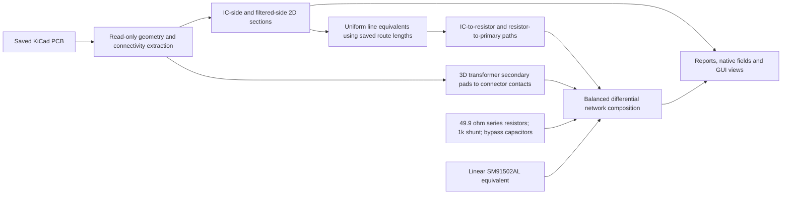

# COMH/COML electromagnetic study

Copyright (C) 2021-2026 Gerhard Malberg.
SPDX-License-Identifier: CERN-OHL-P-2.0

The EM scope is the two on-board communication paths from BQ79616-Q1 U201 to
J501/J502 contact heads, through their filters and isolation transformers.
Cables, mating connectors, cell-tap/NTC/supply studies and unrelated magnetic
parts are excluded. The former `sim/daisy-chain/` directory is removed;
transformer coupling belongs here.

The [completed reduced-study report](report/README.md) contains the images,
CSV, Touchstone and provenance snapshot. Six native CPU cases completed; the
COML filtered section is diagnostic-only. IC-side local Zdiff is 102.144 Ω /
101.141 Ω for COMH / COML. Primary routing uses uniform line equivalents, and
COML's filtered line explicitly uses COMH parameters as a proxy. Dense primary
3D meshes failed quality checks; no full IC-to-connector 3D field solution or
engineering acceptance is claimed.

The reusable KiCad → Gmsh → Palace → ParaView toolchain is
[PCB EM Lab](https://github.com/gerhardmalberg88/pcb-em-lab). Install its CLI and
pinned tools/CPU images first. This hardware repository owns all physical case
inputs and the compact result snapshot. It has no mandatory sibling-checkout
path dependency.



| Model | Purpose |
|---|---|
| [2D sections](isospi-2d/README.md) | Four local sections; real L/C and uniform line equivalents at 4 MHz |
| [3D PCB regions](isospi-3d/README.md) | Transformer pads to connector contacts at 1, 4 and 10 MHz |
| [Transformer/filter composition](transformer-coupling/README.md) | Complete balanced small-signal board-path network |

Run from the hardware repository root:

```bash
python3 sim/em/run-study.py --time-budget-minutes 180
bash sim/em/transformer-coupling/run.sh
```

If the CLI is not installed on `PATH`, pass `--pcb-em /path/to/pcb-em`.
The runner uses CPU, two MPI ranks and one thread per rank, reuses verified
stage caches, limits each case to 20 minutes and reserves two minutes for
shutdown. It meshes first and refuses meshes above 70,000 nodes before starting
the solver (`--max-mesh-nodes` overrides this host-oriented safeguard). Timeout cleanup targets only new containers mounted on that job's
exact output directory. Completed outputs and interrupted logs are retained.
The component-model script verifies completed stages, artifact hashes and
matching current design inputs before combining them.

Native outputs stay ignored under `sim/results/em/`: extracted geometry,
BREP/MSH, physical groups, Palace JSON/CSV/PVD/VTU, logs, stage manifests,
reports, PNGs and ParaView states. Compact figures, CSVs and portable provenance
are kept in `report/` after successful publication with `python3 sim/em/publish.py`.
No transient fit is exported
from three frequency points.

GUI reopening uses the same files, for example:

```bash
pcb-em gui gmsh --workdir sim/results/em/comh-connector-3d/mesh -- /work/board.msh
pcb-em gui paraview --workdir sim/results/em/comh-ic-routing-3d -- --state=/work/postprocess/view.pvsm
```

The main field solve uses tolerance `1e-8`; the flux-error estimator uses `1e-2`
for bounded runtime. A same-mesh check produced identical saved port results
when changing only the estimator tolerance. Its indicators remain approximate
diagnostics.

Dense IC/filter 3D meshes failed quality checks and are excluded. The complete
path therefore uses explicit section-derived lossless lines on the primary side,
plus the successful 3D secondary/contact network. The primary-side approximation
does not resolve bends, pads, varying cross-sections or common-mode conversion.

The 3D images are individual basis-port excitations; they are not populated-board
operating fields. Results remain exploratory: PEC copper, estimated materials,
separate finite crop domains, unqualified meshes and a simplified balanced
transformer/filter circuit. No acceptance against the provisional 100 Ω intent,
common-mode behavior, hardware correlation, EMC or electrical isolation is
established. See [CMU-007](../../docs/CMU-007-si-pi-analysis.md) for the design context.

Case inputs use JSON. Published provenance names the current `.json` inputs;
`recorded_case` preserves their original names from completed runs. Renaming
the files did not change their contents or recorded case hashes. Native run
records remain unchanged.
