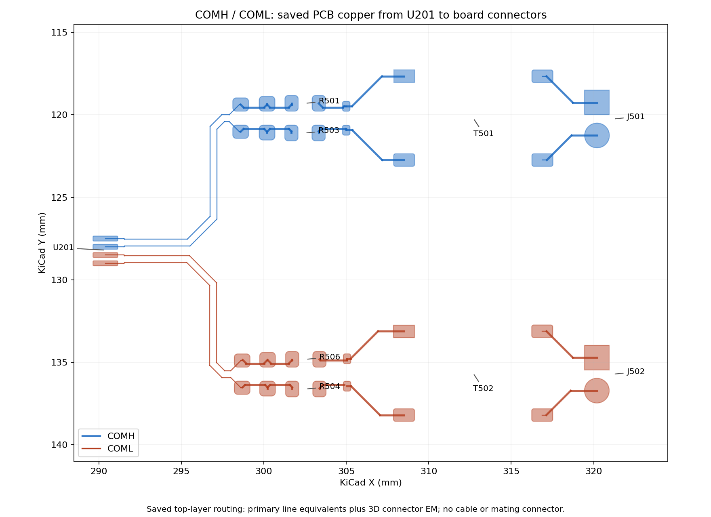
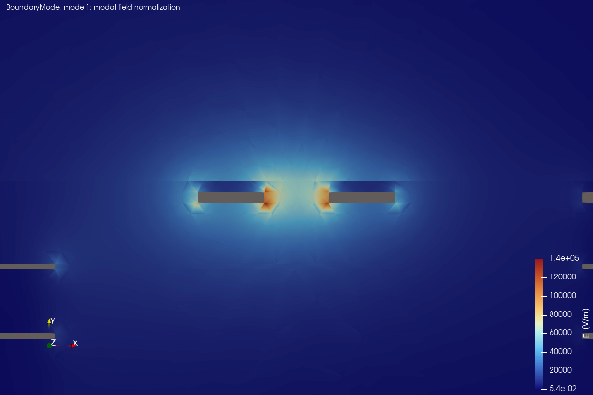
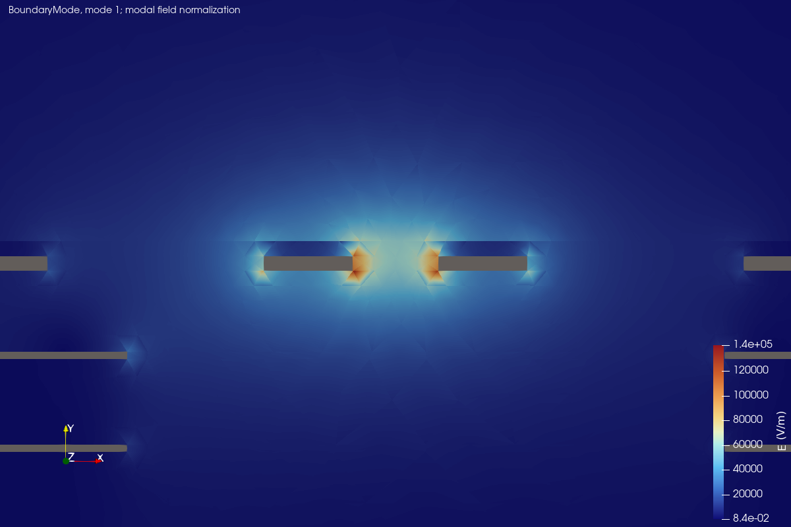
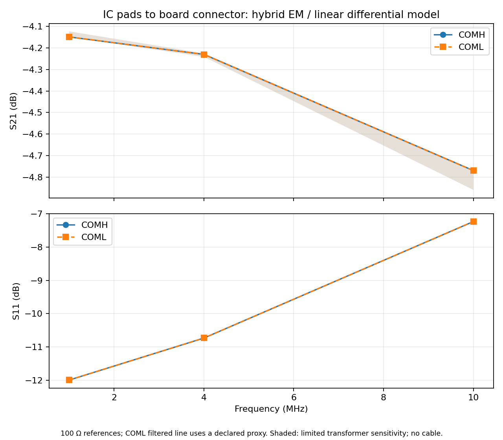
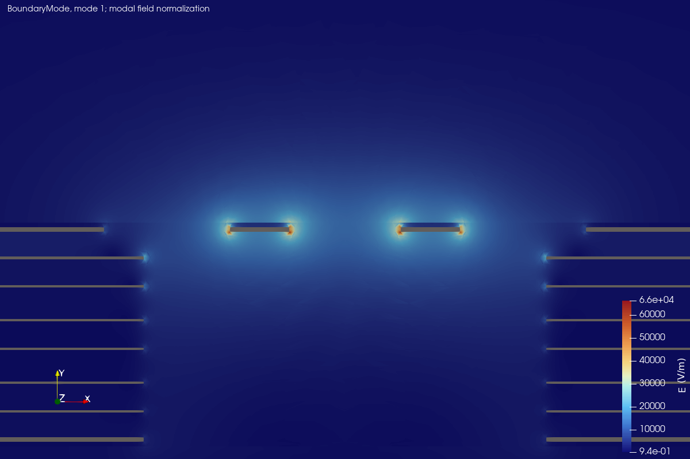
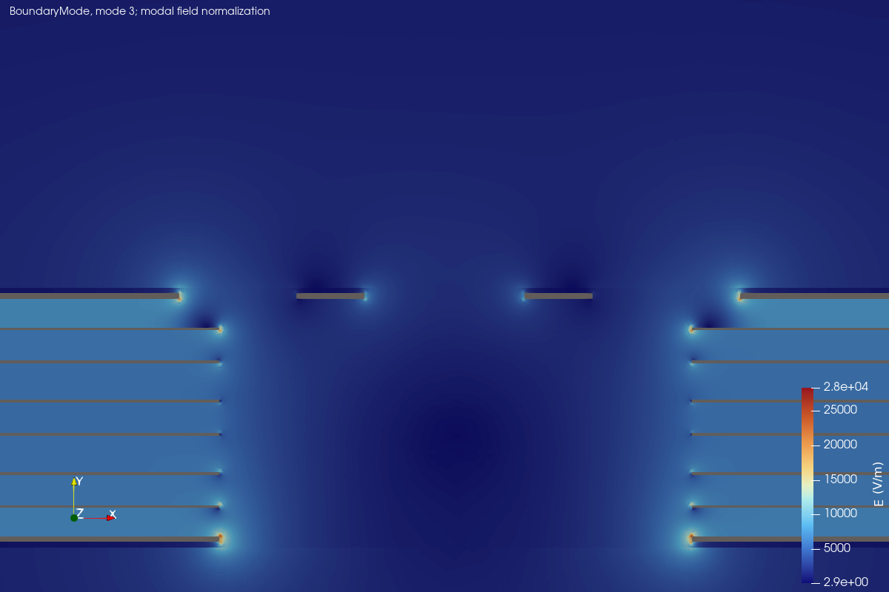
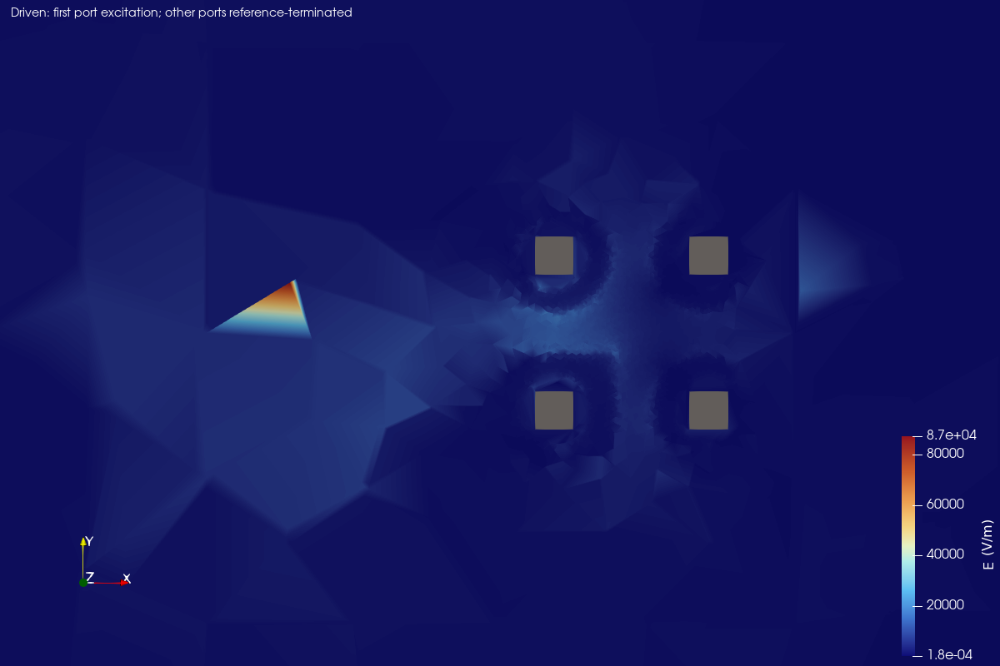
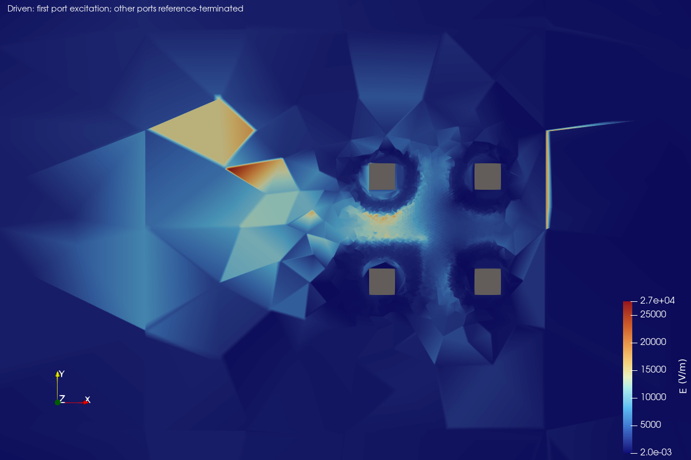

# COMH/COML board-only EM results

Six native CPU cases completed (COML filtered section is diagnostic only): two local sections and one 3D connector region per channel. The primary-side routes use explicit section-derived line equivalents; dense primary 3D meshes failed quality checks and are excluded. The combined model runs from U201 pads to J501/J502 contact heads. Cables and mating connectors are excluded.

**Provisional hybrid EM/circuit results.** Completion records execution, not mesh/domain convergence, hardware correlation, EMC approval or isolation qualification. The two route-length line equivalents and the connector 3D network per channel are joined by the balanced component equivalent documented in [the model guide](../transformer-coupling/README.md).

## Local sections

| Channel | Section | Baseline Zdiff at 4 MHz (Ω) |
|---|---|---:|
| COMH | IC-side | 102.144 |
| COMH | filtered-side | 123.409 |
| COML | IC-side | 101.141 |
| COML | filtered-side | Not accepted: ambiguous modes |

**COML filtered-section warning:** its automatic parity-screened 4.5 Ω candidate is not accepted as the signal impedance. The combined COML model explicitly uses COMH filtered L/C as a proxy with the actual COML route length; layout differences remain unqualified.

The IC-side cuts use 0.45 mm traces with a 0.20 mm gap; the filtered-side cuts have different saved spacing. These local impedances are not full-path input impedances. Native modal fields are shown below; their normalization is not an operating voltage.

| COMH section | COML section |
|---|---|
|  |  |

The 0.05 / 0.035 / 0.025 mm section mesh checks and 6-to-9 mm vertical-air-domain check are in [convergence.csv](convergence.csv). They are limited sensitivity checks; the lateral section width, 3D fields, materials and populated component model are not qualified by them.

## Complete balanced board path

| Channel | Frequency (MHz) | S21 (dB) | S11 (dB) |
|---|---:|---:|---:|
| COMH | 1 | -4.149 | -11.994 |
| COMH | 4 | -4.230 | -10.732 |
| COMH | 10 | -4.769 | -7.234 |
| COML | 1 | -4.149 | -11.994 |
| COML | 4 | -4.230 | -10.732 |
| COML | 10 | -4.770 | -7.233 |

The 100 Ω wave reference is a reporting convention, not a BQ79616 driver output-resistance model. Three frequency samples do not establish interpolation or fast-edge/transient accuracy. Shading varies only assumed transformer magnetizing/leakage inductance; it is not a full device tolerance bound.

Native combined networks: [COMH](comh.s2p), [COML](coml.s2p). Scalars: [board-path.csv](board-path.csv), [summary.csv](summary.csv).

## PCB basis fields

| Region | COMH | COML |
|---|---|---|
| Filtered-pair section |  |  |
| Connector-side 3D PCB |  |  |

These are first-port basis excitations with other ports reference-terminated, not the populated-board operating field. Images use separate automatic color scales. The section pictures are normalized eigenfields; the COML filtered picture is a rejected diagnostic mode, not an accepted differential line mode. The secondary half-port picture does not drive both halves as the combined balanced circuit does. Field peaks are not dielectric-stress predictions.

## Assumptions and evidence

- Balanced linear differential small-signal circuit from IC pads to board connector contacts; no IC die, driver waveform, cable or mating connector.
- IC-side and filtered-side routing use lossless uniform transmission-line equivalents from real 4 MHz section L/C and mean saved P/N route lengths. Bends, pads, neck-downs, asymmetric lengths and frequency dependence are not resolved along the full route. This is an approximation after the dense 3D primary meshes failed quality checks.
- Only the transformer-secondary-to-connector region is a 3D field network. There is no validated 3D field solution from the IC to the transformer primary. Coupling between separately represented path sections is omitted.
- COML filtered-section modes are ambiguous; the parity-screened 4.5 ohm candidate is not accepted as the signal impedance. COML uses COMH filtered-section L/C as an explicit proxy with its own saved route length. Different spacing/surroundings and common-mode mixing remain unqualified.
- Half-port voltages are added and equal currents imposed using Z_reduced = C^T Z C. Center taps have zero external differential current and no added physical ground connection.
- Two equal 220 pF capacitors to local ground become 110 pF differential capacitance. Their load and the 1k shunt are collapsed to the series-resistor input plane; individual pad-location effects are omitted.
- The primary 100 pF center-tap bypass carries no current in this balanced reduction. Common-mode behavior, mode conversion and asymmetric loading are outside this model.
- TVS nonlinear behavior and off-state capacitance, component lead/package parasitics, transformer core loss and interwinding capacitance are omitted.
- 3D copper is PEC sheet copper. Narrow 1-10 MHz sampling is not fast-edge, eye-diagram, BER, EMC or isolation qualification.

The connector 3D field tolerance is 1e-8; the 2D section tolerance is 1e-9. The approximate flux-error estimator uses 1e-2; a same-mesh diagnostic kept saved port values unchanged. Very thin positive-quality tetrahedra remain, so local field peaks and 3D absolute values require caution. Mesh quality, physical inputs, source/image/stage/artifact hashes and component mappings are retained in [provenance.json](provenance.json).

Native FEM meshes, field collections, solver inputs/logs and ParaView states remain locally under ignored `sim/results/em/`. Reproduce with the commands in the [EM guide](../README.md). No other EM simulation is scheduled in this repository. Measured hardware correlation remains separate.
