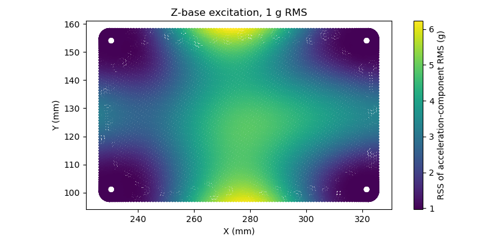
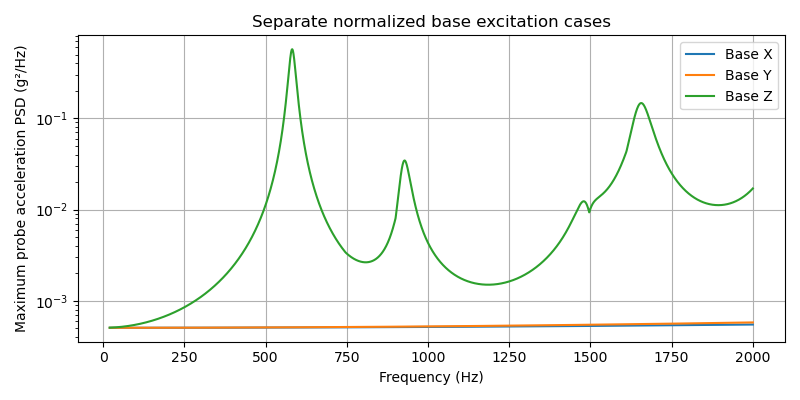

# BMS CMU modal and PSD results

**Completed CPU/GPU runs; provisional results. The componentwise RMS mesh-convergence check failed.**

These are the existing 2026-11-02 simulations, republished after input and artifact hash verification; no FEM rerun was performed.

| Backend | Uncached total, both meshes | Execution | Mesh acceptance |
|---|---:|---|---|
| CPU | 7.90 min | All stages completed | Failed RMS check |
| CUDA | 53.20 min | All stages completed | Failed RMS check |

Installation and image builds are excluded. Timings include extraction, both meshes, modal analysis, PSD, reporting and mesh comparison.

## Modal results

| Mode | CPU 3 mm mesh (Hz) | CPU 2 mm mesh (Hz) |
|---|---:|---:|
| 1 | 580.73 | 581.65 |
| 2 | 922.85 | 925.60 |
| 3 | 1493.38 | 1489.81 |
| 4 | 1660.28 | 1653.85 |
| 5 | 2120.01 | 2102.59 |
| 6 | 2382.81 | 2381.94 |
| 7 | 2444.26 | 2440.74 |
| 8 | 3604.63 | 3599.72 |
| 9 | 3738.06 | 3731.93 |
| 10 | 4011.70 | 4008.42 |

First-ten-frequency mesh change: **0.829%**, below 2%. Each run retains 16 modes through at least 6608 Hz; eigenpair residuals are below 1e-6 and mass-orthogonality errors below 1e-6.

## PSD response

Fine CPU mesh, 2% damping. Values are spatial maxima of individual response-component RMS, not time-domain peaks; different columns may attain their maxima at different locations.

| Independent base axis | Relative displacement (µm) | Absolute acceleration (g RMS) | Stress component (MPa RMS) | Strain component (µstrain RMS) |
|---|---:|---:|---:|---:|
| X | 0.002774 | 1.0151 | 0.0084224 | 0.34217 |
| Y | 0.0044849 | 1.0245 | 0.0079497 | 0.3153 |
| Z | 3.7143 | 6.2259 | 0.77494 | 29.788 |

**RMS mesh convergence failed:** the maximum gated probe change is 840.53% (limit 5%). This includes very small cross-axis displacement components; weak recovered surface shear is also mesh-sensitive. The comparison uses a floor of 1% of the peak reference component within each sampled field. Small magnitude does not waive the gate.

CPU/GPU agreement passed on both identical meshes (frequency tolerance 0.1%, RMS tolerance 1%). PSD integration and modal-truncation checks passed separately; neither backend agreement nor accurate eigenpairs establishes mesh or physical-model convergence. [Numerical checks](checks.json) include effective modal masses, damping sensitivities and per-field errors.

The board plot shows the root-sum-square of acceleration-component RMS for Z-base excitation, in g.

The PSD plot is the maximum across sampled probe DOFs at each frequency; it is an envelope, not the spectrum of one fixed response location.

## Model and limits

The saved 1.708 mm PCB is homogenized with E=24.37 GPa, ν=0.165 and density=1944 kg/m³. These are generic effective properties, not measured board properties. Top/bottom 7 mm outer-diameter annular contacts at H1–H4 are assumed rigid. Quadratic solids use two thickness layers and 3/2 mm in-plane meshes (79,815/133,305 displacement unknowns).

157 fitted component masses are distributed over attachment regions without package stiffness or mass offsets; DNP parts are excluded. Four connector masses use manufacturer data; 153 use dimensional/material estimates with ±50% screening uncertainty. The assembled board-plus-component mass is approximately 28.484 g. See the [mass audit](mass-audit.csv).

Excitation is synthetic, one-sided flat 1/1980 g²/Hz over 20–2000 Hz: 1 g RMS separately in X, Y and Z. Damping is 2%, with 1% and 5% sensitivity calculations. Modal cross terms, support-node mass coupling, residual flexibility and the direct base-motion term in absolute acceleration are included. Low retained in-plane effective mass is reported explicitly; the static residual contribution is not a substitute for dynamic in-plane modes.

Cables, enclosure flexibility, package stiffness, nonlinear contacts and solder joints are omitted. Stress is component RMS, not RMS von Mises. No fatigue-life, component-qualification or hardware-acceptance claim follows from these provisional fields.

## Files and reproduction

- [Case and commands](../README.md) · [explicit case](../case.json)
- [Modal frequencies, participation and residuals](modal-frequencies.csv) · [RMS response, SI units](rms-response.csv)
- [Numerical checks](checks.json) · [source, tool and artifact provenance](provenance.json)

Reading this report needs no native archive or lab checkout. Raw meshes, matrices, mode fields and logs remain outside tracked content. Hardware inputs and this publication retain CERN-OHL-P-2.0; upstream tools retain their own licenses.
