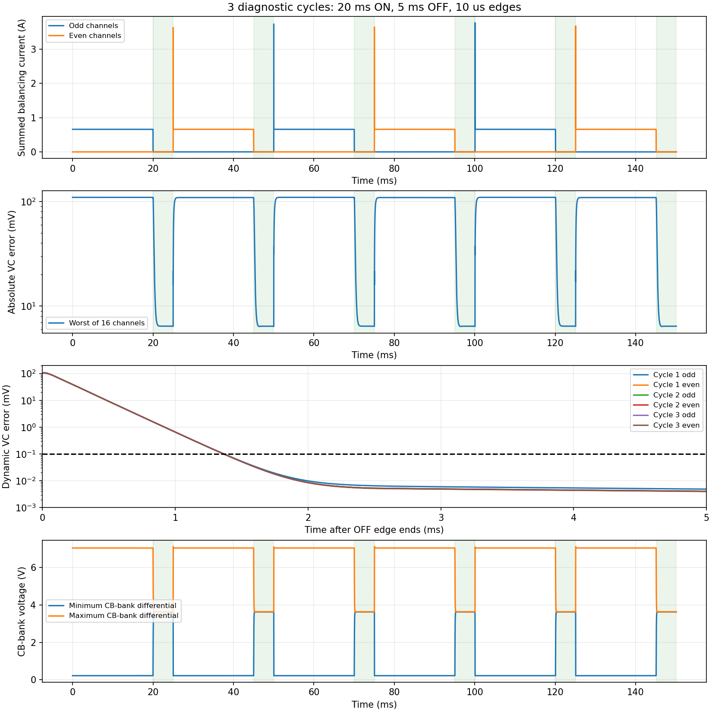

# Repeated balancing cycle — results

One ngspice transient study of the approved wired LG M50 / BQ79616 circuit,
with a separate half-timestep verification run. All numerical checks passed.
No other SPICE studies are published or retained as native results.

The schedule repeats **odd ON → OFF → even ON → OFF** 3 times.
Each ON plateau lasts 20 ms; OFF gaps last 5 ms,
with assumed 10 us smoothstep switching edges.
The first odd phase starts from its DC operating point. These are diagnostic
short-time timings, not a claimed firmware schedule or steady periodic limit.

| Cycle | Phase just switched OFF | VC settling (ms) | CB settling (ms) | Remaining pin-level window (ms) | End absolute VC error (mV) |
|---|---|---:|---:|---:|---:|
| 1 | odd | 1.368 | 0.472 | 3.632 | 6.439 |
| 1 | even | 1.366 | 0.473 | 3.634 | 6.432 |
| 2 | odd | 1.366 | 0.473 | 3.634 | 6.438 |
| 2 | even | 1.366 | 0.473 | 3.634 | 6.432 |
| 3 | odd | 1.366 | 0.473 | 3.634 | 6.438 |
| 3 | even | 1.366 | 0.473 | 3.634 | 6.432 |

The worst modeled VC settling time is **1.368 ms**. All 6 tested OFF gaps
provide a pin-level quiet window under these assumptions. Settling means all
16 differential VC errors remain within **0.1 mV of the independently solved final
OFF-state offset** through the remainder of that gap. Times start when the
physical OFF edge ends. The next ON edge is excluded. No first-crossing shortcut
is used. Cell-terminal voltage is the reference, so real cell relaxation is not
counted as sensing error.

Waiting does not remove the modeled **6.434 mV** maximum DC offset.
Assumed board/input loading through shared wire, contact and fuse impedances
produces the endpoint-channel offsets. These are model predictions, not measured
board errors. The CB values are external capacitor-bank voltages.

## Evidence and limits

- [Window measurements](windows.csv), [all 16 channels](channels.csv).
- [Verification](validation.json): waveform timestep agreement, settling-time
  agreement, independent DC/KCL, native Qucs-export DC agreement drawn-wire connectivity and an absolute-coordinate transient
  cross-check through the first OFF transition. Maximum VC waveform difference:
  **5.299 uV**.
- [Provenance](provenance.json): exact source, implementation and output hashes.
- Native ngspice decks, logs and waveforms:
  `sim/results/cell-voltage-input-filter/repeated-cycle/` (ignored by Git).
- [Run instructions](../README.md), [approved circuit](../circuit/cell-filter-16-cells-with-wires.sch).

The report uses the finer 1 us maximum-step waveform. The
2 us run is supporting verification of the same study.
Both use Gear integration and identical physical values. Display downsampling
does not affect CSV measurements or verification.

The exported topology is retained. Floating cell R||C pairs use an equivalent
scaled state preserving R/(1+sRC); switches use the same ports with a finite
conductance edge. Commands use equivalent time expressions instead of forced
PWL breakpoints. The transient solves exact perturbations about the initial DC
state, retaining switched bias currents and restoring physical output offsets.
This avoids loss of precision from the large stack common-mode voltage. The cell impedance split, relaxation, package inductance,
switch capacitance and edge remain assumptions. No internal ADC or digital-filter
model is applied. This study does not establish register-read timing, a guaranteed
hardware wait, tolerance bounds, fast-edge protection qualification or ADC accuracy.
