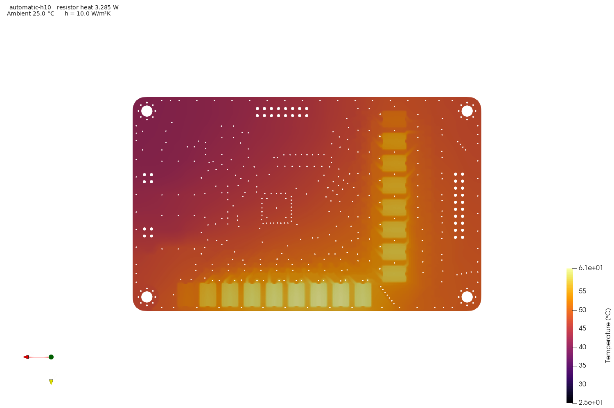
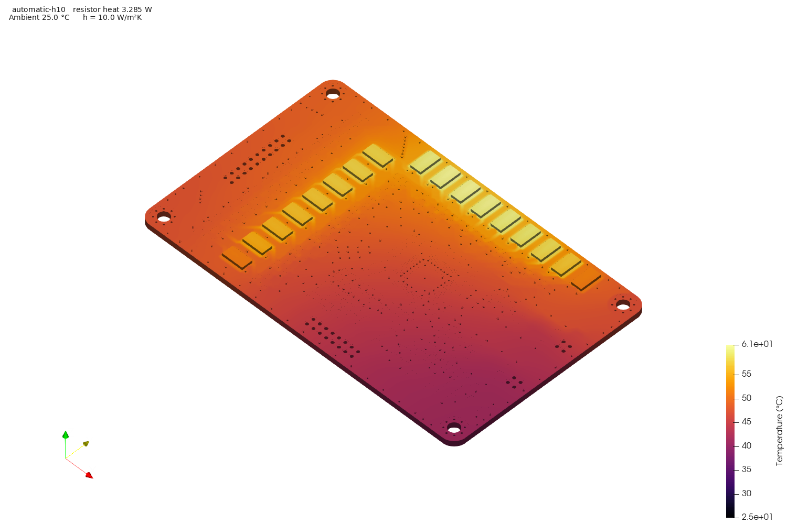
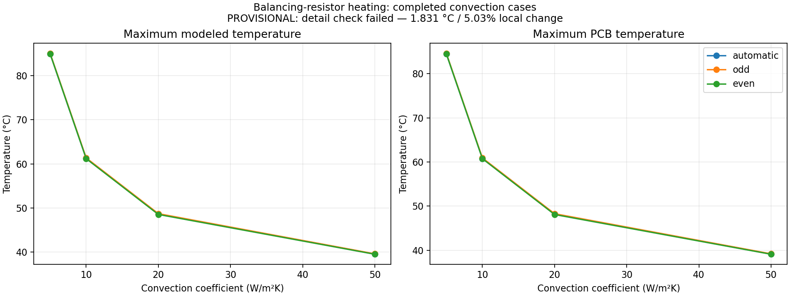

# Cell balancing resistors: heating and PCB cooling

Copyright (C) 2021-2026 Gerhard Malberg.
SPDX-License-Identifier: CERN-OHL-P-2.0

Only the 17 balancing resistors generate heat in this study. The whole PCB
conducts it. **The BMS thermal simulation scope is closed at the completed
steady-state study; no further thermal simulations are planned.** The failed
detail check remains an unresolved model limitation. These are provisional
model predictions, not measured operating limits.

## Completed cases and optional reproduction

| Case | Applied resistor heating | Meaning |
|---|---|---|
| [Automatic](config.json) | Cycle-averaged five-second odd/even alternation | Long-term steady prediction for automatic balancing |
| [Odd only](odd.json) | Channels 1, 3, …, 15 continuously active | One phase held indefinitely for comparison |
| [Even only](even.json) | Channels 2, 4, …, 16 continuously active | The other phase held indefinitely for comparison |

Automatic balancing does **not** turn on all channels simultaneously. Each phase
heats 16 resistors: the 15 internal tap resistors are shared between phases,
while endpoint R361 (CB0) heats only during odd operation and R313 (CB16) only
during even operation. The steady automatic case applies half power to each
endpoint and full phase power to the other 15 resistors. It does not resolve the
five-second temperature ripple. Odd/even steady cases retain the same total watts
but place the endpoint heat differently; they are comparison cases, not cooldown
intervals.

Install the standalone [PCB Thermal Lab CLI](https://github.com/gerhardmalberg88/pcb-thermal-lab#quick-start)
and build its CPU/tools images. No sibling checkout arrangement is required.
The results are already published; these commands are for optional reproduction,
not pending tests. From this hardware repository's root, with the CLI environment
activated:

```bash
pcb-thermal run "$PWD/sim/thermal/cell-balancing-resistors/config.json" --backend cpu
pcb-thermal study "$PWD/sim/thermal/cell-balancing-resistors/config.json" \
  --section steady --schedules automatic odd even --time-budget-minutes 120
```

The second command reproduces all three steady schedules, reusing verified
results where possible, at h = 10, 5, 50, 20 W/m²K, sequentially on CPU with two MPI ranks and one thread
per rank. It allows 20 minutes for the first case including preparation and
12 minutes per later case, within an overall 120-minute budget with two minutes
reserved for shutdown. No further detailed-region or transient study is included.

The saved design is exported without saving or refilling it. Input, implementation,
image and artifact hashes control stage reuse. Generated runs and native Elmer
outputs remain ignored under `sim/results/thermal/cell-balancing-resistors/`.
The output parent holds `study-steady.json`, `study-steady.csv`, `study-steady.md`
and `steady-convection.png`, checkpointed after every accepted case. Status is
complete, failed, budget-exhausted or interrupted; failures retain prior results.

## Electrical operating assumption

All cells stay at 4.2 V. Each CB tap has a nominal 20 Ω resistor. Using the
BQ79616-Q1 minimum switch resistance of 1.45 Ω, one active nonadjacent balancing
channel carries `4.2 / (20 + 20 + 1.45) = 0.101327 A`. Each resistor in its path
then dissipates 0.205343 W. The tool checks CB0…CB16 connectivity against the
saved PCB before assigning power; reference names alone do not establish it.

| CB node | Resistor | CB node | Resistor |
|---|---|---|---|
| CB0 | R361 | CB9 | R362 |
| CB1 | R354 | CB10 | R355 |
| CB2 | R347 | CB11 | R348 |
| CB3 | R340 | CB12 | R341 |
| CB4 | R333 | CB13 | R334 |
| CB5 | R326 | CB14 | R327 |
| CB6 | R319 | CB15 | R320 |
| CB7 | R312 | CB16 | R313 |
| CB8 | R304 | | |

Automatic balancing alternates eight odd and eight even channels every five
seconds. The fifteen internal tap resistors participate in both phases; only
the two endpoints alternate between full power and zero. Their cycle averages
are 0.102671 W each; the other fifteen average 0.205343 W each. Total resistor
heat is **3.285485 W**. The **0.119099 W** switch loss is included in electrical
accounting and excluded from the FEM heat sources, as requested. No AFE,
regulator, fuse or other component losses are applied. Continuous odd and even
cases each have the same total resistor load with different endpoint heating.

The datasheet minimum switch resistance maximizes this nominal resistor load;
resistor tolerance, cell depletion and thermal balancing pauses are outside
this fixed-voltage operating assumption. This replaces neither the full board
power budget nor the preliminary 3.7 W allocation in CMU-002.

## Geometry, materials and cooling

The whole PCB conducts heat. Copper on every layer, hollow plated through
barrels, laminate, saved soldermask openings, solder, terminals and resistor
ceramic are explicit within 10 mm of the selected footprints. Outside that area,
5 mm tiles use orthotropic properties derived from actual copper/via fractions:
parallel averaging in-plane, series resistance through thickness and
volume-weighted heat capacity. This approximation does not resolve every remote
copper connection. Holes and cutouts remain voids.

The production mesh uses 0.5 mm local and 3 mm remote target sizes, scale 1,
0.01 mm polygon chord error, and 0.1 µm overlay snapping. It contains 2,052,022
nodes and 3,603,579 prisms. Dimensions enter the solver in metres exactly once.
Barrel plating is assumed 25 µm and solder thickness 100 µm, with ideal bonded
interfaces. These inputs remain editable in each case.

| Material | Conductivity x/y/z, W/mK | Density, kg/m³ | Heat capacity, J/kgK |
|---|---|---:|---:|
| Copper | 400 / 400 / 400 | 8960 | 385 |
| FR4 | 0.8 / 0.8 / 0.3 | 1850 | 1100 |
| Soldermask | 0.2 / 0.2 / 0.2 | 1200 | 1000 |
| Resistor ceramic | 25 / 25 / 25 | 3900 | 880 |
| Effective terminal | 67 / 67 / 67 | 7310 | 230 |
| Solder | 50 / 50 / 50 | 7400 | 230 |

These are engineering assumptions, not supplier-certified thermal properties.
Power is uniform within each modeled resistor ceramic body; its maximum is not
a validated resistive-film or junction temperature.

Ambient is 25 °C. Convection acts only on exposed surfaces, with h = 5, 10, 20
and 50 W/m²K. These coefficients are sensitivity inputs, not measured airflow.
Radiation, enclosure and mounting heat paths, mechanical cooling parts, cell
voltage depletion and balancing thermal pauses are disabled. Other component
bodies and losses are omitted; their PCB copper remains. Nearby board temperatures
are not component junction temperatures or external NTC measurement errors.

## Completed steady results — provisional

**All twelve steady solves completed and passed input, output and heat-balance
checks. The detailed-region convergence check failed.** These are provisional
model predictions, not validated local resistor temperatures or operating limits.

| h, W/m²K | Automatic maximum, °C | Odd-only maximum, °C | Even-only maximum, °C |
|---:|---:|---:|---:|
| 5 | 84.9592 | 85.0832 | 84.9663 |
| 10 | 61.2413 | 61.3571 | 61.1884 |
| 20 | 48.6308 | 48.7197 | 48.5419 |
| 50 | 39.5647 | 39.6090 | 39.5203 |

The three curves nearly overlap because total resistor heat is the same and
15 resistors are shared between phases; only endpoint heating differs. The
tracked [CSV](report/summary.csv) also contains PCB maxima, heat residuals,
solver runtimes and sampled peak RSS. Its `prediction_status` explicitly records
`domain_unconverged`. The largest relative heat imbalance is below 1.44e-9, well below
the required 0.01 (1%). Small heat residuals establish conservation, not model accuracy.

The [provenance snapshot](report/provenance.json) includes case identifiers,
physical assumptions, design/mesh/native-output hashes, tool identities,
mesh/detail comparisons and the interrupted attempt, without machine-local
paths. Large native results remain ignored. Figures use completed, checked
solver outputs and retain the domain-validation limitation below.



**Provisional — detailed-region convergence failed.** Automatic cycle-averaged
heating, top view: 4.2 V cells, 3.285485 W resistor heat, 25 °C ambient,
h=10 W/m²K. Maximum modeled temperature 61.2413 °C; maximum PCB temperature
60.7890 °C. The scale is Celsius; displayed digits are computational precision,
not claimed physical accuracy.



**Provisional — detailed-region convergence failed.** The same automatic h=10
case, isometric view. Only resistor bodies and terminals appear above the PCB;
other component bodies are omitted.



All twelve completed steady cases. Lower temperature at higher h reflects the
assumed convection coefficient, not a measured airflow correlation. The warning
in the figure records the failed 10/20 mm detail check.

## Verification and remaining limits

Every published steady solve has successful native Elmer completion, unchanged
saved-design hashes, intact artifacts and heat imbalance below 1%. Historical
and new cases have matching physical assumptions and identical converted-mesh
hashes. Saved case configurations match their provenance and use generated SIFs.

Three corrected-mask mesh resolutions (scales 1.5, 1 and 0.75) pass: the largest
reported hotspot change from the production baseline to the finest mesh is
0.081435 °C, or 0.2245% of peak rise, below both 1 °C and 2% limits.

The limited automatic h=10 comparison expands explicit detail from 10 to 20 mm.
Both solves pass heat accounting, but **local hotspot convergence fails**:

| Quantity | 10 mm detail, °C | 20 mm detail, °C | Absolute change, °C |
|---|---:|---:|---:|
| Overall maximum | 61.2413 | 61.4036 | 0.1623 |
| R361 maximum | 51.5804 | 53.4113 | 1.8309 |

R361's change is **5.029%** of the 20 mm model's peak temperature rise. It exceeds
both the <1 °C and <2% requirements. Several other resistors also exceed 1 °C.
Checking only the overall maximum would have hidden this failure. The snapshot
retains every per-resistor comparison. The remaining 30 mm and cropped/explicit
domain campaign has been removed from the BMS plan. This closes the work scope
without changing the failed validation result.

The numerical window ran on 2026-10-31 from **20:25:57 to 21:41:14 Helsinki time**
(**75 minutes 16 seconds**, within 120 minutes). The first odd h=10 attempt
stopped at the host-memory reserve during flux calculation after 11 minutes
45 seconds. After freeing host RAM, one CPU retry completed all eight missing
cases and the limited comparison, retaining the original deadline and limits.
All runs used two MPI ranks and one thread per rank. New production solves took
275–322 seconds, with approximately 7.24 GB sampled peak process-tree RSS.
Keep headroom for the 1.5 GiB host reserve and other applications; the 8 GiB
solver cap remains enabled. All batch jobs are stopped.

## Closed scope and excluded simulations

The planned 1,800 s balancing plus 1,800 s cooling run and half-step check are
canceled; the transient case file and unused transient settings in the steady
cases have been removed. Steady results describe equilibrium under the modeled
loads. Warm-up time, cooldown and five-second temperature ripple were not
established, and the reported maximum is not a measured or universal peak.

There are **no remaining thermal simulation tasks in this BMS project**. Further
detail/crop refinement, BMS CPU/CUDA comparison, direct-solver experiments,
combined component heating, fault heating, enclosure/mounting variants and
sensor-error thermal simulations are excluded from the closed scope. The
[scope-closure record](../../../docs/CMU-006-thermal-analysis.md) lists their
final disposition. They are not marked as completed or passed tests.

The small reusable lab fixtures remain available for tool development. Their
transient and backend checks do not establish BMS transient convergence or
BMS GPU agreement. Hardware correlation and thermal qualification remain
unperformed engineering validation, separate from this closed simulation plan.
Existing figures, numerical results, hashes and native diagnostic evidence are
retained. They can be committed as provisional results without further runs.

## Inspect native outputs

Each accepted run preserves `convert/mesh`, `solve/case.sif`, the ElmerGUI
project under `solve/mesh`, native restart/results, VTU/PVTU collections,
scalar and line samples with column descriptions, convergence logs and resources.
Derived reports are under `postprocess`, including summary/history/resistor CSV,
JSON, PNG views and a relocatable ParaView state.

```bash
thermal_run="$PWD/sim/results/thermal/cell-balancing-resistors/automatic-h10"
pcb-thermal gui paraview --workdir "$thermal_run" -- --state=/work/postprocess/view.pvsm
pcb-thermal gui gmsh --workdir "$thermal_run/mesh" -- /work/board.msh
pcb-thermal gui freecad --workdir "$thermal_run/extract" -- /work/board.step
pcb-thermal gui elmer --workdir "$thermal_run/solve/mesh"
```

In ElmerGUI load the project directory `/work`. GUI SIF regeneration can replace
scripted settings. Copy a run before manual edits; use an explicitly supplied
`--sif /path/to/edited.sif` for a scripted rerun. The original design remains
read-only during the pipeline; a selected GUI working directory is writable.
